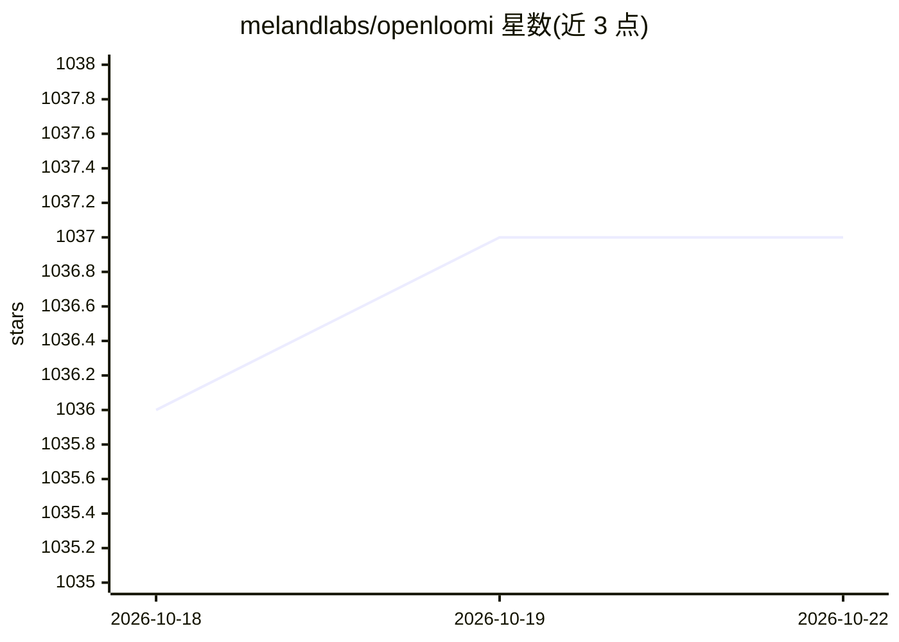

# melandlabs/openloomi

⭐ 1,037 · TypeScript · Apache-2.0 · 推送 2026-09-24 · [GitHub](https://github.com/melandlabs/openloomi) · [官网](https://openloomi.ai/) · 组织维护 · 中文 README

**开源桌面 AI 同事：连接工作工具，汇总上下文并主动提醒待办**

面向个人用户的常驻桌面 AI 应用（Attention Agent）：通过平台连接器自动拉取 commits、issue、邮件、文档等信号，构建跨工具的短中长记忆与上下文图，以桌面气泡形式输出决策卡片、9 点晨报与 6 点日总结，并支持在 Telegram/WhatsApp/iMessage/QQ/Lark 等聊天应用内直接使用 AI。本地优先存储、AES-256 加密、数据不出本机。功能同时以开源 Skills/Plugins 形式提供，可接入 Claude Code、Codex、OpenCode、Hermes、OpenClaw 等 agent 框架。README 自述为早期软件。

## 筛选速览

| 维度 | 判定 | 备注 |
|---|---|---|
| AI 角色 | `ai-native` | 本体是模型或模型工具 |
| 许可风险 | `permissive` | Apache-2.0 |
| 部署形态 | `library` | 以包/库形式分发 |
| 模型依赖 | — | README 未给出锁定关系 |
| 硬件要求 | — | 无带数字的原话,不猜 |
| 安装摩擦 | `low` | 无编译、无系统依赖或容器化 |
| 成熟度 | `idea` | |

## 能力要点

- Auto-fetch 后台同步拉取 commits/issues/邮件/文档进入上下文图
- 短中长记忆：跨工具记录人、项目与决策，可见可审计
- 官方插件将 Claude Code / Codex 变为本地 OpenLoomi 运行时的前端
- 本地优先存储、AES-256 加密、可审计访问日志

## 适用场景

- 把散落在 Slack/Gmail/Notion 等工具里的工作上下文集中到一处检索
- 接收每日晨报、日终回顾与逾期回复提醒
- 在 Telegram、WhatsApp、iMessage、QQ、Lark 中直接让 AI 起草回复或总结长串消息
- 为已有的 Claude Code / Codex agent 补充跨工具工作区上下文

## 场景标签

`AI 助手` `Agent 记忆` · 领域:Agent 开发

## 证据(README 行号)

> L21: **Focus on what matters. This is your Attention Agent.**
> L32: - **Ask AI for work help right inside your chat.** Draft a reply, summarize a long thread, schedule a follow-up — d
> L42: |🔌|**Platform Connectors**|**Auto-fetch** background sync loop pulls commits, issues, emails, and docs proactively 

## 星数曲线

2026-10-18 1,036 → 2026-10-22 1,037（+1）

---
*卡片 v1 · prompt 1.4 · 生成 2026-10-21 · 置信度 high · 依据 README sha `c10ecdc01073` · [字段定义](../../DATASET.md)*
