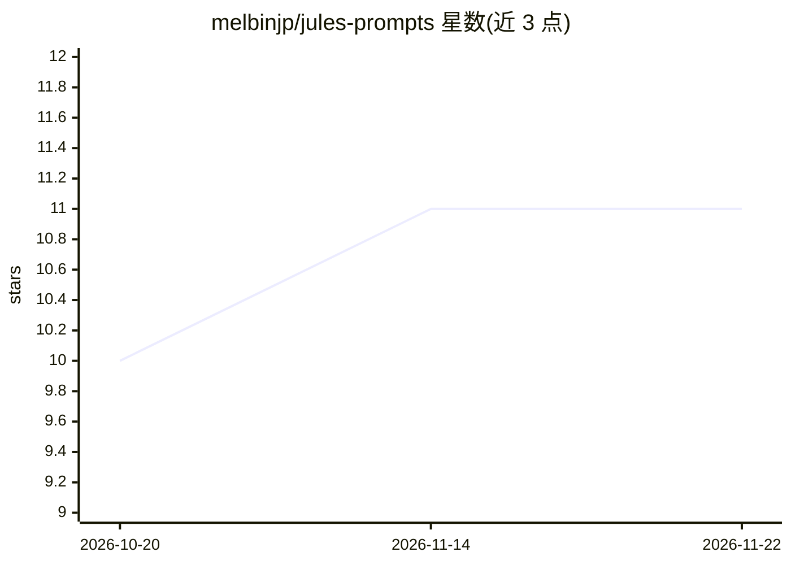

# melbinjp/jules-prompts

⭐ 11 · Python · MIT · 推送 2026-10-08 · [GitHub](https://github.com/melbinjp/jules-prompts) · [官网](https://jules-prompts.wecanuseai.com/) · 个人维护

**为 Jules 等编码 Agent 提供机器可读任务提示词库**

一个面向 Jules、Claude Code、Codex、Cursor 等编码 Agent 的提示词与 Agent Skill 库，核心是名为 conductor 的单一技能：从零或从已有项目出发，按目标与验收、交付物、责任、依赖、执行权限、验证、变更与交接等职责推进项目，并以证据作为完成判定、要求非作者复核。原 26 个技能的库已退役并映射到 conductor。安装方式为将 conductor/ 文件夹复制进目标项目的 skill 目录，全部内容可离线运行，不需要托管服务。附带 26 个植入缺陷的迷你项目作为回归测试夹具与评分脚本。

## 筛选速览

| 维度 | 判定 | 备注 |
|---|---|---|
| AI 角色 | `ai-knowledge` | 知识聚合/清单类 |
| 许可风险 | `permissive` | MIT |
| 部署形态 | `None` |  |
| 模型依赖 | — | README 未给出锁定关系 |
| 硬件要求 | — | 无带数字的原话,不猜 |
| 安装摩擦 | `low` | 无编译、无系统依赖或容器化 |
| 成熟度 | — | 结构信号不足 |

## 能力要点

- conductor 单一 Agent Skill：覆盖从想法到交付与交接的项目职责清单
- 机器可读提示词，兼容 .agents/skills 与 .claude/skills 两种安装入口
- 26 个植入缺陷的 fixtures 与 score_fixture.py 评分脚本用于回归验证
- 全部离线可用，不需要网络与托管服务

## 适用场景

- 为 Jules 或 Claude Code 等编码 Agent 安装项目交付流程指引
- 用植入缺陷的夹具测试模型报告的可靠性
- 在私有项目中离线使用 Agent 技能而不泄露访问痕迹
- 用 AGENTS.md 常驻规则约束 Agent 行为

## 场景标签

`提示工程` · 领域:Agent 开发

## 证据(README 行号)

> L1: # Jules Prompts
> L20: The name is historical: the library began in 2025 as prompts for Jules, Google's coding agent, and
> L99: - `SKILL.md`: classify the project, the control loop, work records, procedures

## 星数曲线

2026-10-20 10 → 2026-11-22 11（+1）

---
*卡片 v1 · prompt 1.4 · 生成 2026-11-18 · 置信度 high · 依据 README sha `9334ddef2705` · [字段定义](../../DATASET.md)*
