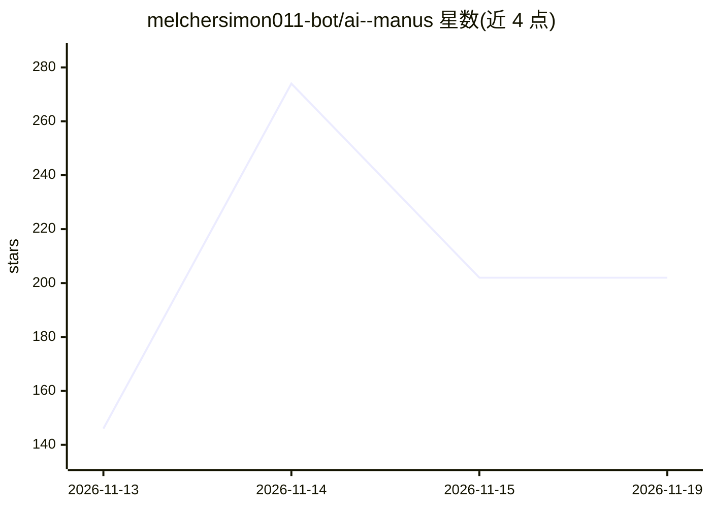

# melchersimon011-bot/ai--manus

⭐ 202 · Apache-2.0 · 推送 2026-11-15 · [GitHub](https://github.com/melchersimon011-bot/ai--manus) · 个人维护

**自主 AI Agent：代用户执行代码与控制浏览器完成任务**

README 描述 Manus 为自主运行的 AI Agent，能够自行编写并执行脚本、控制浏览器（打开网页、填表单、抓取信息），并以多步骤任务的形式在少量监督下完成工作，定位面向家庭、学习与轻量办公场景的小型助手，而非企业平台。声明具有跨会话的任务模式记忆。README 为营销式介绍，未提供具体的安装命令、技术架构、模型接入方式或代码入口；描述中提到权限要求与硬件兼容性表格，但缺乏可验证的实现细节。

## 筛选速览

| 维度 | 判定 | 备注 |
|---|---|---|
| AI 角色 | `ai-native` | 本体是模型或模型工具 |
| 许可风险 | `permissive` | Apache-2.0 |
| 部署形态 | `None` |  |
| 模型依赖 | — | README 未给出锁定关系 |
| 硬件要求 | — | 无带数字的原话,不猜 |
| 安装摩擦 | `low` | 无编译、无系统依赖或容器化 |
| 成熟度 | — | 结构信号不足 |

## 能力要点

- 声明支持自主编写并执行代码
- 声明支持浏览器控制（导航、填表、信息采集）
- 声明支持多步骤任务与跨会话模式记忆

## 适用场景

- 让 agent 代为执行重复性的脚本与网页操作
- 学习与研究中收集资料、整理笔记
- 轻量办公中的多页面信息汇总

## 场景标签

`编码 Agent` `浏览器自动化` · 领域:效率与自动化

## 证据(README 行号)

> L10: - **Autonomous Code Execution:** Manus AI agent runs code on its own to complete tasks, so you can focus on decisio
> L18: Manus is an autonomous AI agent designed to run code and control a browser on your behalf. Instead of acting like a

## 星数曲线

2026-11-13 146 → 2026-11-19 202（+56）

---
*卡片 v1 · prompt 1.4 · 生成 2026-11-17 · 置信度 low · 依据 README sha `0f78ee3a5dd2` · [字段定义](../../DATASET.md)*
