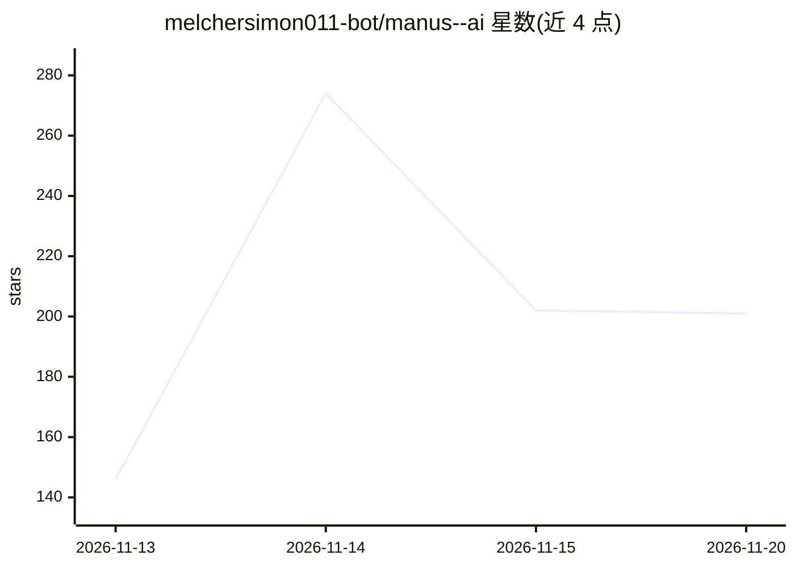

# melchersimon011-bot/manus--ai

⭐ 201 · Apache-2.0 · 推送 2026-11-15 · [GitHub](https://github.com/melchersimon011-bot/manus--ai) · 个人维护

**面向个人用户的自主 AI 代理：自动写码执行并控制浏览器**

名为 Manus 的自主 AI 代理系统，定位为个人助手而非企业平台：可自主编写并执行脚本、控制浏览器（导航页面、填写表单、采集信息），并组合代码与浏览器动作完成多步骤任务，目标用户为学生、远程工作者与小项目用户。README 给出硬件兼容表（最低 4GB 内存、双核 CPU）与六步上手流程，但未提供任何安装命令、源码入口或 API 接入说明，也未说明所依赖的模型提供商，内容以功能描述为主。

## 筛选速览

| 维度 | 判定 | 备注 |
|---|---|---|
| AI 角色 | `ai-native` | 本体是模型或模型工具 |
| 许可风险 | `permissive` | Apache-2.0 |
| 部署形态 | `None` |  |
| 模型依赖 | — | README 未给出锁定关系 |
| 硬件要求 | — | 无带数字的原话,不猜 |
| 安装摩擦 | `low` | 无编译、无系统依赖或容器化 |
| 成熟度 | — | 结构信号不足 |

## 能力要点

- 自主编写并执行代码完成任务
- 浏览器控制：导航、填表、信息采集
- 代码与浏览器动作在同一工作流中衔接，支持多步骤任务

## 适用场景

- 让学生整理研究笔记、跑快速计算
- 让代理跨多个网页收集数据并汇总
- 把重复的小型日常任务委托给后台代理执行

## 场景标签

`AI 助手` `编码 Agent` `浏览器自动化` · 领域:效率与自动化

## 证据(README 行号)

> L18: Manus is an autonomous AI agent designed to run code and control a browser on your behalf. Instead of acting like a
> L22: Manus is not a heavy studio suite or a complex enterprise platform. It is a focused helper built for home, study, a

## 星数曲线

2026-11-13 146 → 2026-11-20 201（+55）

---
*卡片 v1 · prompt 1.4 · 生成 2026-11-17 · 置信度 mid · 依据 README sha `fbfd5e977bf4` · [字段定义](../../DATASET.md)*
