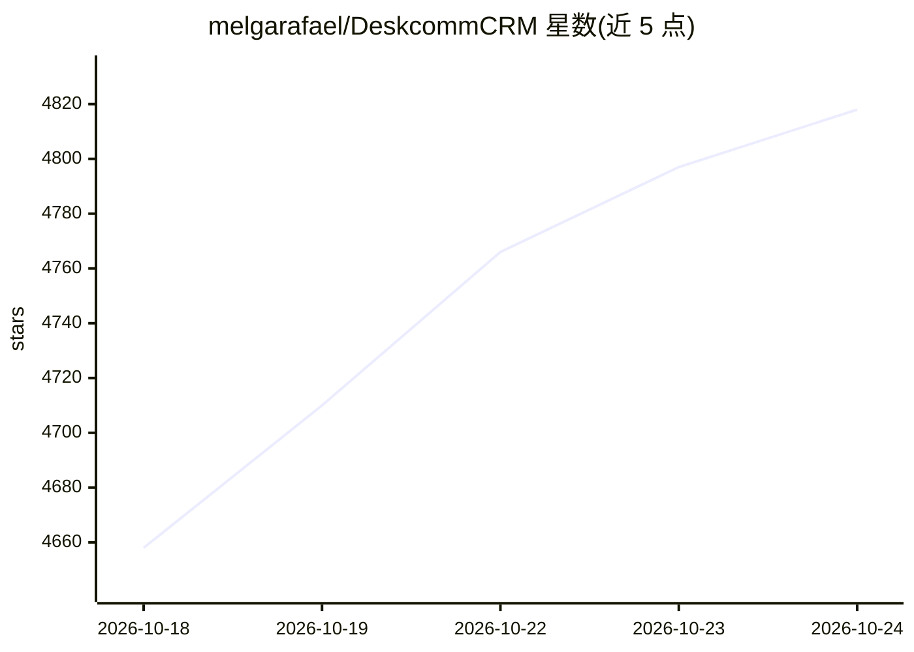

# melgarafael/DeskcommCRM

⭐ 4,833 · TypeScript · MIT · 推送 2026-10-24 · [GitHub](https://github.com/melgarafael/DeskcommCRM) · [官网](https://deskcomm.com.br) · 个人维护 · 中文 README

**自托管的开源 AI 销售 CRM，AI 代理通过 WhatsApp 接待与成交**

基于 Next.js/TypeScript/Supabase 的自托管多租户 CRM，内置通过 WhatsApp（WAHA/NOWEB 通道）接待、 qualify 与销售的 AI 代理，支持 OpenRouter/Anthropic/OpenAI 密钥。提供 HostGator 合作的一键 VPS 安装脚本（含 ARM64、自动 HTTPS、idempotent 更新与备份/还原工具），自称为 Kommo、Octadesk、Intercom 的开源替代，面向 LGPD 合规的巴西聊天销售企业。MIT 许可。

## 筛选速览

| 维度 | 判定 | 备注 |
|---|---|---|
| AI 角色 | `ai-native` | 本体是模型或模型工具 |
| 许可风险 | `permissive` | MIT |
| 部署形态 | `self-host` | docker 或自建部署 |
| 模型依赖 | locked-api |  |
| 硬件要求 | — | 无带数字的原话,不猜 |
| 安装摩擦 | `low` | 无编译、无系统依赖或容器化 |
| 成熟度 | — | 结构信号不足 |

## 能力要点

- AI 代理在 WhatsApp 通道内接待、qualify 与销售
- install.sh 一键 VPS 部署：自动 HTTPS、幂等安装、支持 ARM64
- 界面内一键更新：自动备份、失败自动回滚到上一镜像
- 配套 backup/restore/healthcheck/reset-MFA 等运维脚本

## 适用场景

- 企业自托管 CRM 并让 AI 代理在 WhatsApp 上做销售接待
- 需要数据自持、无月费的多租户客服/销售系统
- 用一条命令在 VPS 上部署含 WhatsApp 通道的完整销售栈

## 场景标签

`聊天机器人` · 领域:对话与助手

## 证据(README 行号)

> L7: **Agentes de IA que atendem, qualificam e vendem no WhatsApp — dentro de um CRM open source rodando no seu servidor.
> L79: |**IA**|Uma chave de **OpenRouter**, **Anthropic** ou **OpenAI** — o instalador pergunta qual você quer|

## 星数曲线

2026-10-18 4,658 → 2026-10-24 4,818（+160）

---
*卡片 v1 · prompt 1.4 · 生成 2026-10-20 · 置信度 high · 依据 README sha `7c4e74c1f9f7` · [字段定义](../../DATASET.md)*
