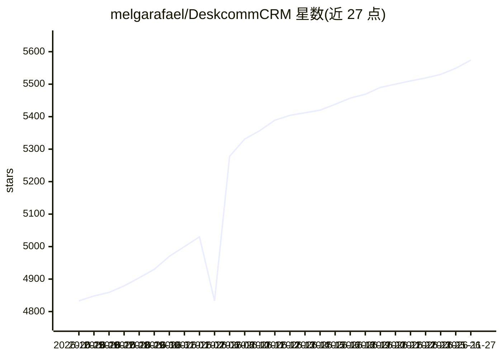

# melgarafael/DeskcommCRM

⭐ 5,574 · TypeScript · MIT · 推送 2026-11-26 · [GitHub](https://github.com/melgarafael/DeskcommCRM) · [官网](https://deskcomm.com.br) · 个人维护

**开源自助托管 CRM：AI agent 经 WhatsApp 接待、销售**

自托管销售 CRM，核心是接入 WhatsApp（经 WAHA）的 AI agent，负责客户接待、资格筛选与销售对话，配有销售漏斗与收件箱界面；支持多租户、MCP 接入，声明遵循 LGPD。技术栈 Next.js + TypeScript + Supabase，MIT 许可，提供 VPS 一键安装脚本（含 Docker 镜像、自动 HTTPS、定时任务与更新代理）、Web 界面更新、备份与健康检查脚本。README 以葡萄牙语为主，定位面向按聊天销售的企业。

## 筛选速览

| 维度 | 判定 | 备注 |
|---|---|---|
| AI 角色 | `ai-native` | 本体是模型或模型工具 |
| 许可风险 | `permissive` | MIT |
| 部署形态 | `self-host` | docker 或自建部署 |
| 模型依赖 | locked-api |  |
| 硬件要求 | — | 无带数字的原话,不猜 |
| 安装摩擦 | `low` | 无编译、无系统依赖或容器化 |
| 成熟度 | — | 结构信号不足 |

## 能力要点

- AI agent 经 WhatsApp（WAHA）自动接待、筛选资格并销售
- 自助托管：install.sh 一键部署，含 HTTPS、cron 与更新代理
- 多租户、MCP 就绪，声明遵循 LGPD
- 支持 Claude Code/Codex/Cursor 等助手的安装引导指南

## 适用场景

- 把 WhatsApp 客服与销售流程放进自有服务器的 CRM
- 让 AI agent 自动回复并筛选潜在客户
- 为不同客户/业务线分别搭建多租户聊天销售系统

## 场景标签

`聊天机器人` · 领域:对话与助手

## 证据(README 行号)

> L7: **Agentes de IA que atendem, qualificam e vendem no WhatsApp — dentro de um CRM open source rodando no seu servidor.
> L8: **Sem mensalidade, sem feature travada, seus dados com você. A alternativa aberta a Kommo, Octadesk e Intercom.**

## 星数曲线

2026-10-25 4,833 → 2026-11-27 5,574（+741）

---
*卡片 v1 · prompt 1.4 · 生成 2026-11-26 · 置信度 high · 依据 README sha `573c42e10263` · [字段定义](../../DATASET.md)*
