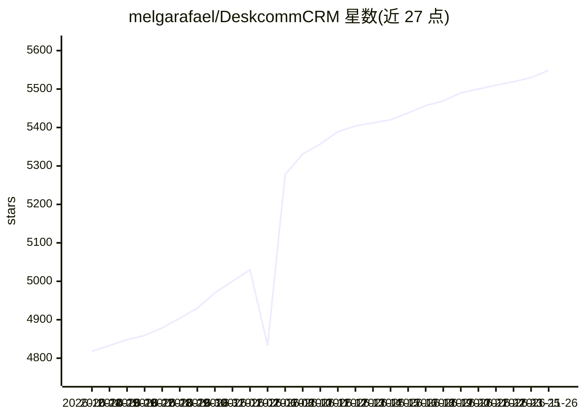

# melgarafael/DeskcommCRM

⭐ 5,549 · TypeScript · MIT · 推送 2026-11-25 · [GitHub](https://github.com/melgarafael/DeskcommCRM) · [官网](https://deskcomm.com.br) · 个人维护

**自托管开源 CRM：AI 代理经 WhatsApp 接待、筛选并成交客户**

以 Next.js + TypeScript + Supabase 构建的自托管销售 CRM，通过 WAHA 连接 WhatsApp，由 AI 代理执行接待、资格筛选与销售对话，支持多租户与 MCP。安装路径为 VPS 上的 git clone 加安装脚本，使用预构建镜像，无需安装 Node 或编译；安装器自动生成密钥、应用数据库 schema、配置 HTTPS 与自动化 cron。依赖外部 Supabase 账号与 OpenRouter/Anthropic/OpenAI 之一的 API key；更新带自动备份与失败回滚，许可为 MIT。

## 筛选速览

| 维度 | 判定 | 备注 |
|---|---|---|
| AI 角色 | `ai-enhanced` | 去掉 AI 部分产品仍成立 |
| 许可风险 | `permissive` | MIT |
| 部署形态 | `self-host` | docker 或自建部署 |
| 模型依赖 | — | README 未给出锁定关系 |
| 硬件要求 | — | 无带数字的原话,不猜 |
| 安装摩擦 | `low` | 无编译、无系统依赖或容器化 |
| 成熟度 | — | 结构信号不足 |

## 能力要点

- AI 代理在 WhatsApp 上执行接待、筛选与销售，CRM 内多租户运行
- 一键安装脚本：预构建镜像、自动生成密钥、应用 schema、配置 HTTPS 与 cron
- 界面内更新流程含自动备份、健康检查与失败回滚到上一版本
- 支持 ARM64/aarch64 VPS 与反向代理环境自动适配

## 适用场景

- 把销售客服机器人部署在自己服务器上运营 WhatsApp 渠道
- 从 Kommo 等托管方案迁移到数据自持的聊天销售 CRM
- 用 AI 代理自动筛选和跟进聊天来的潜在客户

## 场景标签

`聊天机器人` · 领域:对话与助手

## 证据(README 行号)

> L5: # 🛠️ DeskcommCRM — o Sistema Operacional de Vendas com IA, open source, pro WhatsApp
> L7: **Agentes de IA que atendem, qualificam e vendem no WhatsApp — dentro de um CRM open source rodando no seu servidor.
> L85: |**IA**|Uma chave de **OpenRouter**, **Anthropic** ou **OpenAI** — o instalador pergunta qual você quer|

## 星数曲线

2026-10-24 4,818 → 2026-11-26 5,549（+731）

---
*卡片 v1 · prompt 1.4 · 生成 2026-11-22 · 置信度 mid · 依据 README sha `8099cf41d53c` · [字段定义](../../DATASET.md)*
