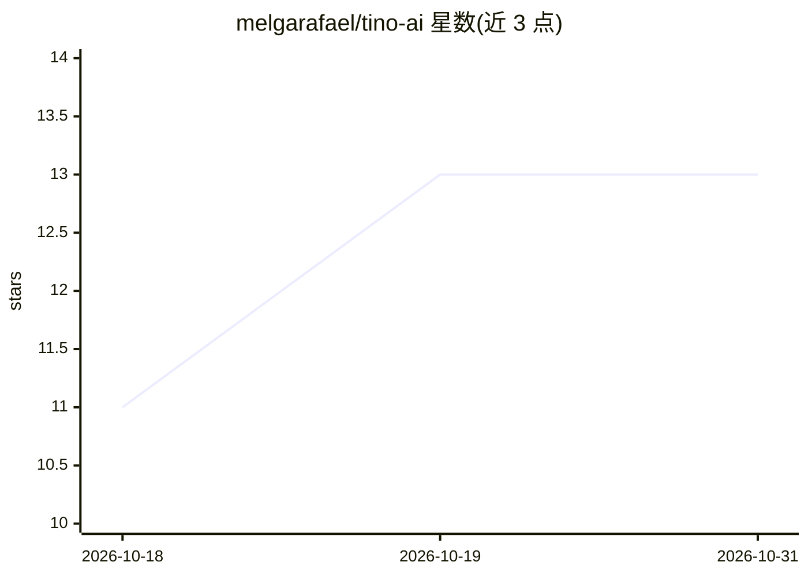

# melgarafael/tino-ai

⭐ 13 · JavaScript · 推送 2026-05-18 · [GitHub](https://github.com/melgarafael/tino-ai) · 个人维护

**本地优先的 AI 资讯策展工具：跑在 Claude Code 内，按你的 Obsidian 笔记排序资讯**

运行于用户本机 Claude Code 中的个人资讯策展工具：扫描用户 Obsidian vault 提取兴趣画像（30 篇高信号笔记→_perfil.md），从 30+ 个 RSS 源抓取 AI 资讯，由 ranker 子代理对每条按 0–10 打分并写入 vault，附引用 vault 真实文件的个性化理由，每日最多 5 条“今日聚焦”。另含面向新手 vibecoder 的 Claude Code 配置向导（生成 CLAUDE.md、settings.json 补丁）与两个纯启发式 runtime hooks（anti-preguiçoso/anti-burro，70–100ms，不调用 Claude API）。提供 --mock 确定性模式，无 LLM 可离线运行；数据不出本机。

## 筛选速览

| 维度 | 判定 | 备注 |
|---|---|---|
| AI 角色 | `ai-native` | 本体是模型或模型工具 |
| 许可风险 | `none` | — |
| 部署形态 | `library` | 以包/库形式分发 |
| 模型依赖 | locked-api |  |
| 硬件要求 | — | 无带数字的原话,不猜 |
| 安装摩擦 | `low` | 无编译、无系统依赖或容器化 |
| 成熟度 | — | 结构信号不足 |

## 能力要点

- vault 画像驱动的资讯排序，每条附引用 vault 真实文件的个性化理由
- 30+ RSS 源抓取，产出最多 5 条“今日聚焦”，其余归组或丢弃
- vibecoder 向导：12 题访谈→推荐 skills/agents/MCPs→生成 CLAUDE.md 与 install.sh
- --mock 确定性模式：纯启发式排序，可离线运行并逐行审计

## 适用场景

- 我想让 AI 帮我筛掉每天刷不完的 AI 资讯，只留和我当前项目相关的几条
- 把 AI 动态直接写进我的 Obsidian 笔记库，方便链接和回顾
- 刚开始用 Claude Code 编程，想要按我的水平配置好 skills 和 hooks

## 场景标签

`网页抓取` · 领域:效率与自动化

## 证据(README 行号)

> L3: Tino é um segundo-leitor discreto. Ele roda 100% na sua máquina, dentro do seu Claude Code, lê o seu vault Obsidian,
> L50: |Subagent|`ranker`|Ranqueia novidades contra o perfil|
> L241: 2. `scripts/rank.mjs --mock` rankeia cada item contra seu `_perfil.md`, dando nota 0–10 e um veredito (Foca · Cons

## 星数曲线

2026-10-18 11 → 2026-10-31 13（+2）

---
*卡片 v1 · prompt 1.4 · 生成 2026-10-31 · 置信度 high · 依据 README sha `daf9ad8d19ae` · [字段定义](../../DATASET.md)*
