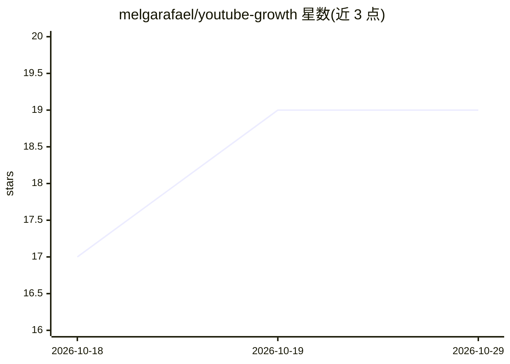

# melgarafael/youtube-growth

⭐ 19 · Python · MIT · 推送 2026-07-15 · [GitHub](https://github.com/melgarafael/youtube-growth) · 个人维护

**终端里运行的 YouTube 增长 AI 代理插件，读取自有频道数据**

面向 Claude Code 与 OpenClaw 的开源插件，为 YouTube 创作者提供增长代理：通过 YouTube 官方 API 连接用户自己的频道，读取真实数据（views、留存、竞品基准），构建存于本地目录的'第二大脑'（vault），再基于此进行选题、脚本、缩略图、SEO/GEO 元数据生成与视频全流程（主题→脚本→剪辑→排期→上传）。GEO 部分针对被 ChatGPT/Perplexity 引用做文本优化。凭据保存在 ~/.config/ 本地，不发送到第三方服务器。v0.2/v0.3 功能处于真实测试阶段。

## 筛选速览

| 维度 | 判定 | 备注 |
|---|---|---|
| AI 角色 | `ai-native` | 本体是模型或模型工具 |
| 许可风险 | `permissive` | MIT |
| 部署形态 | `None` |  |
| 模型依赖 | locked-api |  |
| 硬件要求 | — | 无带数字的原话,不猜 |
| 安装摩擦 | `low` | 无编译、无系统依赖或容器化 |
| 成熟度 | `idea` | |

## 能力要点

- 通过 YouTube 官方 API 读取自有频道真实数据
- 本地'第二大脑' vault：画像、目标、领域笔记
- 主题→脚本→剪辑→排期→发布 的视频全流程代理
- 面向 AI 引用（GEO）的文本优化与 API 上传/排期

## 适用场景

- YouTube 创作者基于自己频道的数据生成选题与脚本
- 优化视频文本元数据以提高被 ChatGPT/Perplexity 引用的机会
- 在本地终端管理从策划到发布的视频制作循环

## 场景标签

`知识库管理` `AI 写作` · 领域:内容生成

## 证据(README 行号)

> L15: `youtube-growth` conecta no seu canal **de verdade** (pela API oficial do YouTube), lê seus dados reais e monta um 
> L32: Um comando (`/youtube-growth:start`) e a IA conduz o resto:
> L116: - [x] **Fase 3 — O Ciclo de Vídeo** *(v0.3, no plugin · em teste real)* — o conductor (`youtube-cycle`) que te lev

## 星数曲线

2026-10-18 17 → 2026-10-29 19（+2）

---
*卡片 v1 · prompt 1.4 · 生成 2026-10-29 · 置信度 high · 依据 README sha `2662cac1de0b` · [字段定义](../../DATASET.md)*
