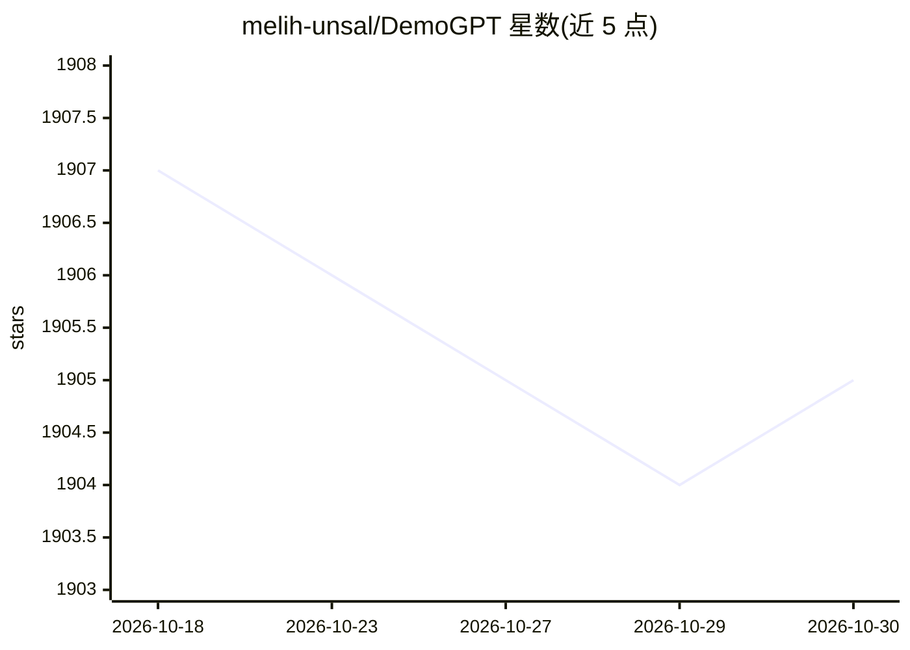

# melih-unsal/DemoGPT

⭐ 1,905 · Python · MIT · 推送 2026-04-01 · [GitHub](https://github.com/melih-unsal/DemoGPT) · 个人维护

**提示词自动生成 LangChain/Streamlit 应用与 Agent 的工具库**

DemoGPT 提供两条能力：一是根据用户指令自动生成 LangChain 代码并组装成交互式 Streamlit 应用，流程为规划→任务创建→代码片段生成→最终组装，默认使用 GPT-3.5-turbo，可选用满足代码生成性能标准的其他 LLM；二是 AgentHub 库，提供 ToolCallingAgent、ReactAgent、内置工具（搜索/天气/Python/YOLO 等 11 种）、RAG 与向量库支持。以 pip 包与源码两种方式安装，可命令行 demogpt 或作为 Python 库调用。To-Do 中多项功能（自精炼、Gorilla、Llama2 集成）尚未完成。

## 筛选速览

| 维度 | 判定 | 备注 |
|---|---|---|
| AI 角色 | `ai-ecosystem` | LLM/agent 周边工具 |
| 许可风险 | `permissive` | MIT |
| 部署形态 | `library` | 以包/库形式分发 |
| 模型依赖 | — | README 未给出锁定关系 |
| 硬件要求 | — | 无带数字的原话,不猜 |
| 安装摩擦 | `low` | 无编译、无系统依赖或容器化 |
| 成熟度 | — | 结构信号不足 |

## 能力要点

- 指令→计划→任务→代码片段→Streamlit 应用的自动生成流水线
- AgentHub 提供 ToolCallingAgent/ReactAgent 与 11 种内置工具
- BaseRAG 支持多种向量库，可在 Agent 内组合 RAG 与工具调用
- 支持模型选择，可用满足代码生成标准的任意 LLM

## 适用场景

- 用自然语言指令快速生成交互式 LLM 演示应用
- 在 Python 项目中构建带工具调用与 RAG 的 Agent
- 复用内置工具（搜索、Python、YOLO 检测等）搭建多步推理 Agent

## 场景标签

`Agent 框架` `代码生成` `编码 Agent` `RAG` · 领域:Agent 开发

## 证据(README 行号)

> L285: 1. **Planning:** DemoGPT starts by generating a plan from the user's instruction.
> L34: DemoGPT AgentHub is a powerful library that allows you to create, customize, and use AI agents with various tools.

## 星数曲线

2026-10-18 1,907 → 2026-10-30 1,905（-2）

---
*卡片 v1 · prompt 1.4 · 生成 2026-10-21 · 置信度 high · 依据 README sha `0c602c1c2f3c` · [字段定义](../../DATASET.md)*
