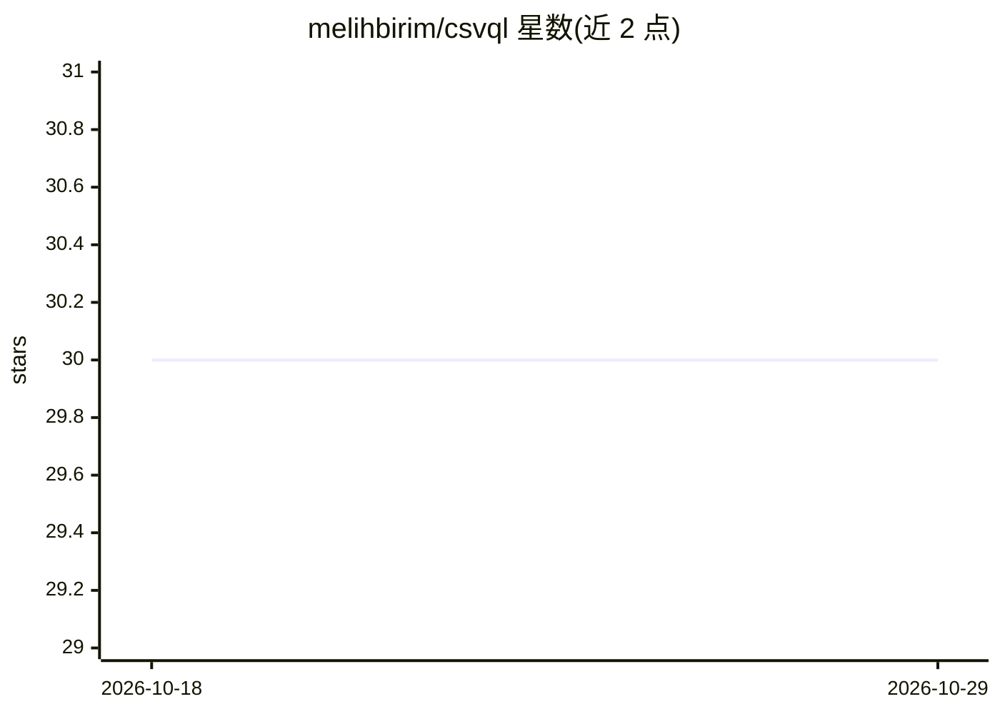

# melihbirim/csvql

⭐ 30 · Zig · MIT · 推送 2026-10-28 · [GitHub](https://github.com/melihbirim/csvql) · [官网](https://melihbirim.github.io/csvql/) · 个人维护

**面向 AI agent 的本地 CSV 只读 SQL 查询引擎与 MCP 服务器**

用 Zig 实现的单二进制查询工具，直接在 CSV 文件所在位置执行 SELECT，无需导入或建库，支持 GROUP BY、内连接、子查询 IN 等子集 SQL，并以 MCP 服务器形式供 Claude Code/Desktop、VS Code Copilot 等 agent 调用，返回限行的 JSON 结果。安全机制包括只读构造（无写语句）、无网络调用、--root 沙箱、输出上限（约100行/12KB）与 --audit JSONL 审计日志。限制：无窗口函数与外连接，仅支持 CSV 输入。提供 Homebrew、预编译二进制、Python/Node 库与源码编译安装。

## 筛选速览

| 维度 | 判定 | 备注 |
|---|---|---|
| AI 角色 | `ai-ecosystem` | LLM/agent 周边工具 |
| 许可风险 | `permissive` | MIT |
| 部署形态 | `desktop` | 安装包/桌面程序 |
| 模型依赖 | locked-api |  |
| 硬件要求 | — | 无带数字的原话,不猜 |
| 安装摩擦 | `low` | 无编译、无系统依赖或容器化 |
| 成熟度 | — | 结构信号不足 |

## 能力要点

- CSV 原地只读 SQL 查询，无需导入/服务器，单个静态 Zig 二进制
- 以 MCP 服务器接入 Claude Code/Desktop 与 VS Code Copilot
- 只读构造、无网络调用、--root 路径沙箱与查询级 JSONL 审计
- 聚合内存平坦（0.7GB 与 8GB 文件均约 74MB）

## 适用场景

- 让 agent 直接查询本机大 CSV 文件，仅取回少量结果行
- 在数据所在服务器上部署并通过 SSH 远程供 agent 查询
- 对 agent 的数据访问做路径沙箱与审计记录

## 场景标签

`数据分析` · 领域:效率与自动化

## 证据(README 行号)

> L7: **Read-only SQL on CSV files, in place, for AI agents.**
> L56: ## For agents (MCP)

## 星数曲线

2026-10-18 30 → 2026-10-29 30（+0）

---
*卡片 v1 · prompt 1.4 · 生成 2026-10-26 · 置信度 high · 依据 README sha `986b3beaaa86` · [字段定义](../../DATASET.md)*
