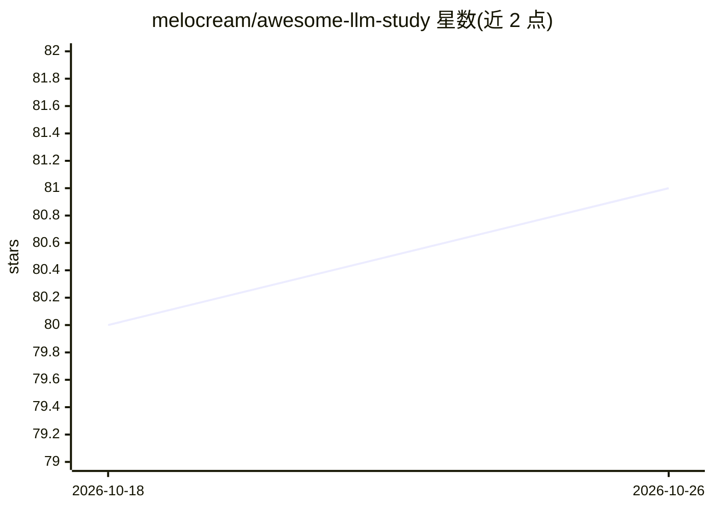

# melocream/awesome-llm-study

⭐ 81 · NOASSERTION · 推送 2026-08-24 · [GitHub](https://github.com/melocream/awesome-llm-study) · [官网](https://marblo.app) · 个人维护

**韩语 LLM 学习资源策展清单：验证过的课程·论文·文档链接**

面向自学 LLM 者的韩语优先知识策展清单：从 Transformer 基础、课程、Agent/MCP、提示工程、RAG、对齐、核心论文、评测观测、本地运行、安全到成本经济，按 4 阶段路线图组织条目。维护者声明所有链接均实际打开验证、无死链，arXiv 链接逐一核对论文标题；每条资源标注先修难度（入门/中级/进阶）与首遍学习时长。许可 CC BY 4.0，维护者附有 marblo.app 产品链接。

## 筛选速览

| 维度 | 判定 | 备注 |
|---|---|---|
| AI 角色 | `ai-knowledge` | 知识聚合/清单类 |
| 许可风险 | `none` | NOASSERTION |
| 部署形态 | `None` |  |
| 模型依赖 | — | README 未给出锁定关系 |
| 硬件要求 | — | 无带数字的原话,不猜 |
| 安装摩擦 | `low` | 无编译、无系统依赖或容器化 |
| 成熟度 | — | 结构信号不足 |

## 能力要点

- 覆盖 LLM 发전史到成本经济学的 12+ 个分类学习资源
- 条目标注先修难度级别与首遍学习时长
- 声明链接逐一验证存活、arXiv 论文标题逐条核对
- 提供四阶段学习路线图（原理→构建→产品→运营）

## 适用场景

- 按路线图系统自学 LLM 原理与工程实践
- 查找各主题（RAG/对齐/评测/MCP）的权威资料与论文
- 为团队 LLM 培训挑选经过验证的课程

## 场景标签

`精选清单` `教程课程` · 领域:学习与行业

## 证据(README 行号)

> L6: > 트랜스포머부터 GPT·Claude, 에이전트·MCP·RAG까지 — **LLM 시대를 스스로 공부하는 분들께 도움이 되고자** 직접 읽고, 보고, 검증한 자료만 모았습니다.
> L15: An opinionated Korean-first, source-verified map for learning LLMs: foundations, building models, agents and MCP, R

## 星数曲线

2026-10-18 80 → 2026-10-26 81（+1）

---
*卡片 v1 · prompt 1.4 · 生成 2026-10-24 · 置信度 high · 依据 README sha `7eaed9dbb206` · [字段定义](../../DATASET.md)*
