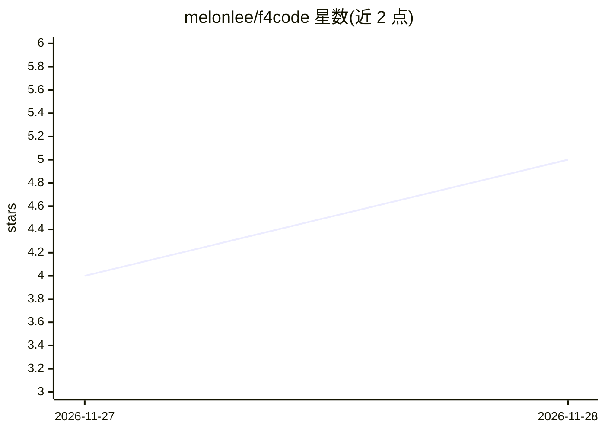

# melonlee/f4code

⭐ 5 · TypeScript · MIT · 推送 2026-11-25 · [GitHub](https://github.com/melonlee/f4code) · 个人维护

**本地模型优先的编程 agent GUI，一处服务器多端接入**

F4code 是面向编程 agent 的图形界面，通过 Node WebSocket 服务器封装多个 agent 的命令行工具（Codex、Claude Code、Cursor、Grok、OpenCode 等），并从同一处向 web、桌面（Electron）与移动（React Native）客户端提供服务。核心机制是本地模型优先：首次运行即自动发现本机上的 Ollama、LM Studio、llama.cpp、vLLM 等服务器并设为默认；后台文本生成默认仅用本地模型；服务器失联时可重新定位而非报不可达。为非官方 fork，MIT 许可，目前无预构建二进制，需从源码构建。

## 筛选速览

| 维度 | 判定 | 备注 |
|---|---|---|
| AI 角色 | `ai-ecosystem` | LLM/agent 周边工具 |
| 许可风险 | `permissive` | MIT |
| 部署形态 | `library` | 以包/库形式分发 |
| 模型依赖 | local-ok | 支持本地模型 |
| 硬件要求 | — | 无带数字的原话,不猜 |
| 安装摩擦 | `low` | 无编译、无系统依赖或容器化 |
| 成熟度 | — | 结构信号不足 |

## 能力要点

- 自动发现本机模型服务器（Ollama、LM Studio、llama.cpp、vLLM、SGLang 等）并链接为默认模型
- 一套 WebSocket 服务器同时服务 web、Electron 桌面与 React Native 移动客户端
- 从代码中删除遥测/分析/崩溃上报，仅保留用户主动发起的网络流量
- 支持 Tailscale、SSH、隧道等远程连接，可选仅私有通道与端到端加密

## 适用场景

- 用自己的硬件跑本地模型驱动编程 agent
- 在多个设备（网页/桌面/手机）接入同一套编码 agent 环境
- 希望代理工具不发送遥测与标识信息

## 场景标签

`编码 Agent` · 领域:编码与开发

## 证据(README 行号)

> L5: A GUI for coding agents that puts models on your own hardware first. A Node WebSocket server wraps
> L15:  palette, F4code finds the servers on your machine (Ollama, LM Studio, llama.cpp, vLLM, SGLang,
> L73: No prebuilt binaries are published for this fork yet, and the update check is not wired to a real

## 星数曲线

2026-11-27 4 → 2026-11-28 5（+1）

---
*卡片 v1 · prompt 1.4 · 生成 2026-11-27 · 置信度 high · 依据 README sha `06942c3a8b30` · [字段定义](../../DATASET.md)*
