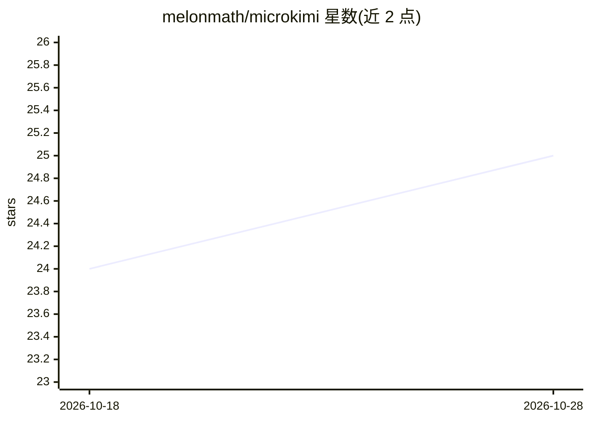

# melonmath/microkimi

⭐ 25 · Rust · MIT · 推送 2026-08-19 · [GitHub](https://github.com/melonmath/microkimi) · 个人维护

**纯 Rust 零依赖的 LLM 推理引擎：运行 Kimi/DeepSeek/Qwen 检查点**

用纯 Rust 从零实现的 LLM 推理引擎，无任何 crate 依赖，单个二进制即可运行 Kimi K3、DeepSeek-V4 与 Qwen3.5 系列检查点，GPU 路径在运行时直接打开 Metal 与 CUDA 驱动。默认路径为位精确 f32，各加速模式均以此测量校验。内置 OpenAI 兼容 API（microkimi serve）、对话版本控制（分叉/对比/合并），并附带 Python 模型手术工具包。作者声明这是面向开发者的框架与引擎，非终端用户产品。

## 筛选速览

| 维度 | 判定 | 备注 |
|---|---|---|
| AI 角色 | `ai-ecosystem` | LLM/agent 周边工具 |
| 许可风险 | `permissive` | MIT |
| 部署形态 | `None` |  |
| 模型依赖 | — | README 未给出锁定关系 |
| 硬件要求 | — | 无带数字的原话,不猜 |
| 安装摩擦 | `high` | 编译与系统依赖俱全 |
| 成熟度 | — | 结构信号不足 |

## 能力要点

- 纯 Rust 零 crate 依赖，单个二进制运行多种检查点
- 默认位精确 f32 路径，加速模式以此为基准测量
- OpenAI 兼容 API 服务（microkimi serve）
- 对话版本控制：分叉历史状态、对比、合并

## 适用场景

- 在单卡或 Apple Silicon 上本地运行 Qwen/Kimi/DeepSeek 检查点
- 通过 OpenAI 兼容接口对外提供推理服务
- 研究者对照位精确基准测试加速模式

## 场景标签

`推理引擎` · 领域:训练与推理

## 证据(README 行号)

> L5: One small binary runs Kimi K3, DeepSeek-V4, and the Qwen3.5 family (Qwen3.8-27B is its default model when converted)
> L10: - **Serve it.** An OpenAI-compatible API lives in the same binary: `microkimi serve`.
> L14: **This is a framework for developers - an engine and a test model, not a product for end-users.**

## 星数曲线

2026-10-18 24 → 2026-10-28 25（+1）

---
*卡片 v1 · prompt 1.4 · 生成 2026-10-27 · 置信度 high · 依据 README sha `de2435dfd449` · [字段定义](../../DATASET.md)*
