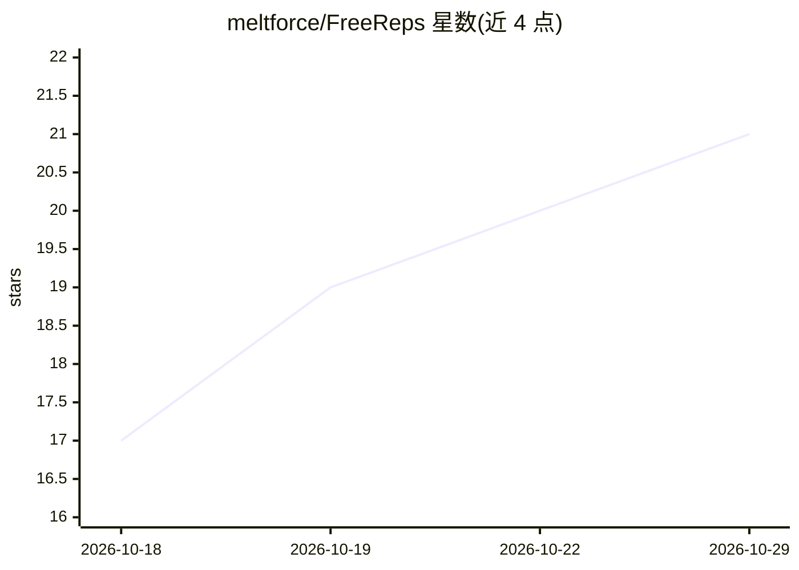

# meltforce/FreeReps

⭐ 21 · Go · MIT · 推送 2026-10-26 · [GitHub](https://github.com/meltforce/FreeReps) · [官网](https://freereps.meltforce.org/) · 个人维护

**自托管健康/训练数据服务器，带可视化仪表盘与 MCP 接口**

自部署的 Go 单二进制服务器，收集 Apple Health（iOS 应用或 Health Auto Export）、Oura、Withings、Hevy、Alpha Progression 的健康与训练数据，持久化到 PostgreSQL+TimescaleDB，通过内嵌 React Web 仪表盘可视化：任意指标间相关性探索（含 Pearson r 与滞后重算）、睡眠分期、心率区间、GPS 路线图。同时以 MCP server 形式（stdio 与 Streamable HTTP）将数据暴露给 LLM。认证与 TLS 依赖 Tailscale，无密码/API key，支持 Docker Compose 部署。

## 筛选速览

| 维度 | 判定 | 备注 |
|---|---|---|
| AI 角色 | `ai-enhanced` | 去掉 AI 部分产品仍成立 |
| 许可风险 | `permissive` | MIT |
| 部署形态 | `self-host` | docker 或自建部署 |
| 模型依赖 | — | README 未给出锁定关系 |
| 硬件要求 | — | 无带数字的原话,不猜 |
| 安装摩擦 | `low` | 无编译、无系统依赖或容器化 |
| 成熟度 | — | 结构信号不足 |

## 能力要点

- 单二进制 Go 服务，内嵌 Web UI，Docker Compose 部署
- MCP 接口（stdio + Streamable HTTP）将健康数据暴露给 LLM
- 任意指标间相关性探索与多来源查询时去重（来源优先级）
- Tailscale 提供认证与 TLS，数据不出自有服务器

## 适用场景

- 把 Apple Health、Oura、Withings 等设备数据集中到自己的服务器并可视化
- 让 LLM 通过 MCP 读取我的健康与训练数据做解读
- 探索睡眠、心率、训练负荷等指标间的相关性

## 场景标签

`数据分析` · 领域:效率与自动化

## 证据(README 行号)

> L5: A self-hosted server that collects health and training data from Apple Health,
> L8: as an MCP server for LLMs.
> L103: - **Data over scores** — Raw data + visualization + LLM instead of proprietary algorithms.

## 星数曲线

2026-10-18 17 → 2026-10-29 21（+4）

---
*卡片 v1 · prompt 1.4 · 生成 2026-10-28 · 置信度 mid · 依据 README sha `0e5f364410db` · [字段定义](../../DATASET.md)*
