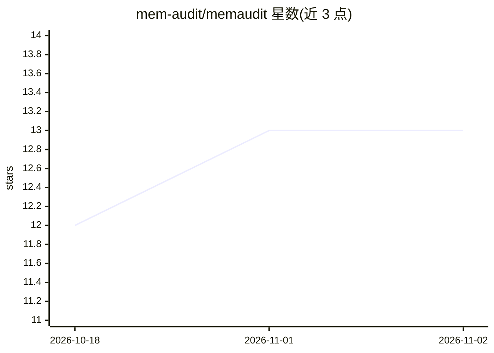

# mem-audit/memaudit

⭐ 13 · Python · Apache-2.0 · 推送 2026-08-30 · [GitHub](https://github.com/mem-audit/memaudit) · [官网](https://ansh200516.github.io/memaudit-site/) · 组织维护

**微调 LLM 训练数据记忆审计插件：金丝雀成员推断+复述检测**

面向 Hugging Face Trainer / TRL 微调流程的本地 Apache-2.0 审计插件：向原始数据集注入预注册金丝雀，训练开始时执行 PEFT 感知的预检（金丝雀可训练性、掩码/格式错误阻断），训练结束写入含成员推断（TPR@1%FPR+CLOPPER-Pearson 区间）与前缀复述两项判定的版本化 JSON 报告；同一引擎也可作为事后 CLI 运行。提供 TinyLlama+Alpaca、TinyDemoLM、distilgpt2 LoRA、TRL SFTTrainer 实测基准。README 明确声明其产出是对抗抵抗证据而非 GDPR/AI Act 合规认证。

## 筛选速览

| 维度 | 判定 | 备注 |
|---|---|---|
| AI 角色 | `ai-ecosystem` | LLM/agent 周边工具 |
| 许可风险 | `permissive` | Apache-2.0 |
| 部署形态 | `library` | 以包/库形式分发 |
| 模型依赖 | — | README 未给出锁定关系 |
| 硬件要求 | — | 无带数字的原话,不猜 |
| 安装摩擦 | `low` | 无编译、无系统依赖或容器化 |
| 成熟度 | — | 结构信号不足 |

## 能力要点

- 训练环内自动注入金丝雀并输出 memaudit-report.json
- 成员推断（Min-K%++、TPR@1%FPR+CLOPPER-Pearson CI）与复述（精确/BLEU/编辑距离）双判定
- PEFT 预检阻断静默误配置（labels=-100、max_length 截断等），对照数不足时拒绝输出 TPR
- 支持 LoRA/adapter 切换评分（disable_adapter）、TRL SFTTrainer 集成与多种子稳定性

## 适用场景

- 合规/安全评审要求下文档化微调模型的记忆风险测试
- 训练环内而非事后上传地执行成员推断与复述审计
- 用预注册金丝雀量化不同 LoRA 配置的泄露差异

## 场景标签

`网络安全` · 领域:学习与行业

## 证据(README 行号)

> L7: **Training-data memorization auditor for Hugging Face Trainer / TRL fine-tunes.**
> L14: memaudit injects pre-registered canaries into the *raw* dataset, runs a PEFT-aware pre-flight when training starts,

## 星数曲线

2026-10-18 12 → 2026-11-02 13（+1）

---
*卡片 v1 · prompt 1.4 · 生成 2026-10-31 · 置信度 high · 依据 README sha `dc8a18107ff7` · [字段定义](../../DATASET.md)*
