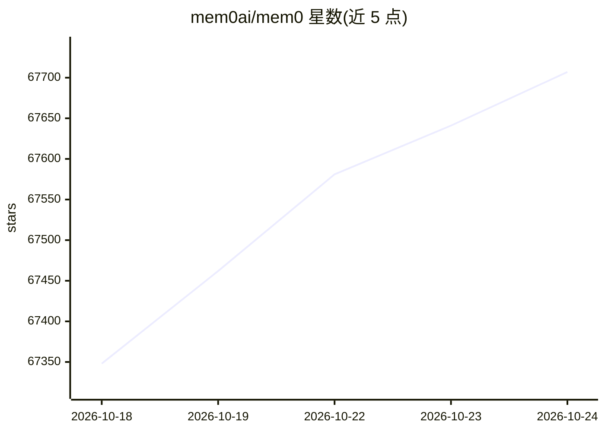

# mem0ai/mem0

⭐ 67,744 · Python · Apache-2.0 · 推送 2026-10-23 · [GitHub](https://github.com/mem0ai/mem0) · [官网](https://mem0.ai) · 组织维护

**为 AI 智能体和应用提供可持久化记忆层的基础设施**

Mem0 为 AI 助手和智能体添加记忆层：记录用户偏好与状态，随交互持续学习。提供三种形态——pip/npm 安装的库（测试原型用）、docker compose 启动的自托管服务器（含 Dashboard 与鉴权）、云平台（托管服务）。记忆提取采用单遍 ADD-only 机制，检索融合语义、BM25 关键词与实体匹配，并含时间感知检索。需外部 LLM 运行（默认 OpenAI gpt-5-mini），嵌入默认 text-embedding-3-small。提供 CLI 管理记忆，Apache 2.0 协议。

## 筛选速览

| 维度 | 判定 | 备注 |
|---|---|---|
| AI 角色 | `ai-native` | 本体是模型或模型工具 |
| 许可风险 | `permissive` | Apache-2.0 |
| 部署形态 | `self-host` | docker 或自建部署 |
| 模型依赖 | — | README 未给出锁定关系 |
| 硬件要求 | — | 无带数字的原话,不猜 |
| 安装摩擦 | `low` | 无编译、无系统依赖或容器化 |
| 成熟度 | — | 结构信号不足 |

## 动量与使用信号

- 维护:`active` — 距上次 push 0.7 天,年发版 100,406 位贡献者
- 涨星:近 1 天 **+74**(自 20261016 起算)
- 安装:npm 包 `@mem0/cli` 月下载 1,305

## 能力要点

- 多层级记忆：User/Session/Agent 状态保留与个性化
- 多信号检索：语义、BM25 关键词、实体匹配并行融合，含时间感知排序
- 提供 Python/JavaScript SDK、CLI 及支持 skills 标准的编码助手技能包
- 库 / Docker 自托管 / 云平台三种部署形态

## 适用场景

- 客服机器人记住历史工单与用户偏好
- AI 助手跨会话保持上下文连续性
- 医疗场景记录患者偏好与历史
- 自托管部署记忆服务供团队使用

## 场景标签

`Agent 记忆` · 领域:Agent 开发

## 证据(README 行号)

> L70: Mem0 ("mem-zero") enhances AI assistants and agents with an intelligent memory layer, enabling personalized AI inte
> L102: |**Setup**|`pip install mem0ai`|`docker compose up`|Sign up at app.mem0.ai|
> L186: Mem0 requires an LLM to function, with `gpt-5-mini` from OpenAI as the default. However, it supports a variety of 

## 星数曲线

2026-10-18 67,348 → 2026-10-24 67,707（+359）

---
*卡片 v1 · prompt 1.4 · 生成 2026-10-18 · 置信度 high · 依据 README sha `9bcaef7b81c3` · [字段定义](../../DATASET.md)*
