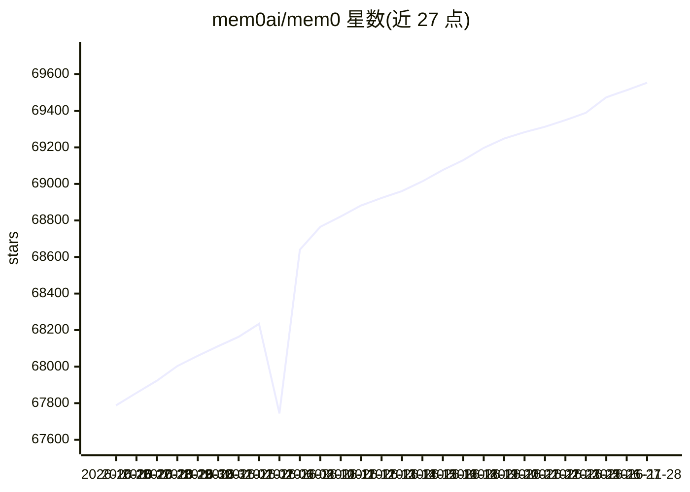

# mem0ai/mem0

⭐ 69,554 · Python · Apache-2.0 · 推送 2026-11-27 · [GitHub](https://github.com/mem0ai/mem0) · [官网](https://mem0.ai) · 组织维护

**为 AI Agent 与应用提供可持久化记忆层的基础设施**

Mem0 为 AI 助手和 Agent 提供记忆层：保存用户偏好、会话与 Agent 状态，跨会话持续学习。新算法采用单次 ADD-only 抽取、实体链接、多信号检索（语义+BM25+实体）与时间感知排序，附开源评测框架。提供三种部署形态：Python/JS 库（测试原型）、Docker 自托管服务器（含认证与 API key）、云平台。需配置 LLM（默认 OpenAI gpt-5-mini）与嵌入模型方可运行，另提供 CLI 与面向编码助手的 Agent Skills。

## 筛选速览

| 维度 | 判定 | 备注 |
|---|---|---|
| AI 角色 | `ai-ecosystem` | LLM/agent 周边工具 |
| 许可风险 | `permissive` | Apache-2.0 |
| 部署形态 | `self-host` | docker 或自建部署 |
| 模型依赖 | — | README 未给出锁定关系 |
| 硬件要求 | — | 无带数字的原话,不猜 |
| 安装摩擦 | `low` | 无编译、无系统依赖或容器化 |
| 成熟度 | — | 结构信号不足 |

## 动量与使用信号

- 维护:`active` — 距上次 push 0.7 天,年发版 100,406 位贡献者
- 涨星:近 1 天 **+74**(自 20261016 起算)
- 安装:npm 包 `@mem0/cli` 月下载 1,305

## 能力要点

- 多级记忆：保留 User、Session、Agent 状态
- 多信号检索：语义、BM25 关键词与实体匹配并行打分融合
- 三种形态：pip/npm 库、docker compose 自托管、云平台
- Agent Skills 通过 npx skills add 安装到编码助手

## 适用场景

- 给客服机器人接入历史工单与用户偏好的记忆
- 让 AI 助手跨会话记住用户偏好与上下文
- 用 Langgraph 或 CrewAI 构建带长期记忆的 Agent

## 场景标签

`Agent 记忆` · 领域:Agent 开发

## 证据(README 行号)

> L64: Mem0 ("mem-zero") enhances AI assistants and agents with an intelligent memory layer, enabling personalized AI inte
> L96: |**Setup**|`pip install mem0ai`|`docker compose up`|Sign up at app.mem0.ai|
> L180: Mem0 requires an LLM to function, with `gpt-5-mini` from OpenAI as the default. However, it supports a variety of 

## 星数曲线

2026-10-26 67,788 → 2026-11-28 69,554（+1,766）

---
*卡片 v1 · prompt 1.4 · 生成 2026-11-26 · 置信度 high · 依据 README sha `4c01ef251b3f` · [字段定义](../../DATASET.md)*
