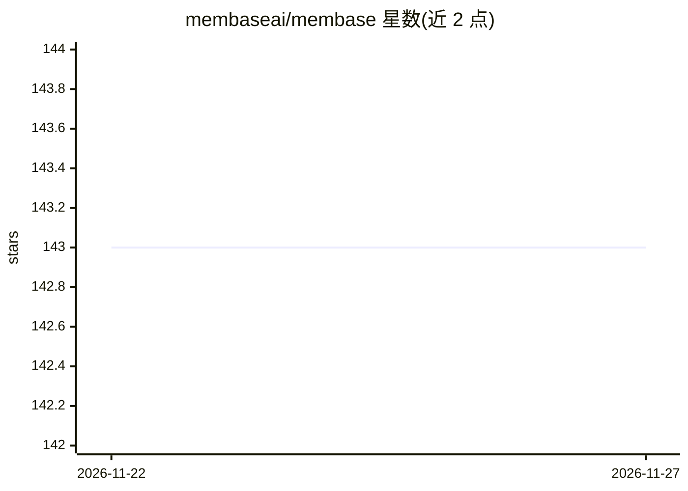

# membaseai/membase

⭐ 143 · Python · MIT · 推送 2026-11-25 · [GitHub](https://github.com/membaseai/membase) · [官网](https://membase.com) · 组织维护

**为 AI agent 提供统一记忆层的 SDK、CLI 与 MCP 服务器**

Membase 为 AI agent 提供记忆层：将事实、文档、网页及 Claude/ChatGPT 聊天导出写入统一记忆，供应用与各 AI 客户端（Claude Code、Cursor、Codex、ChatGPT）通过 SDK 或 MCP 读取。本仓库包含 Python/TypeScript 客户端、membase 命令行与 MCP 服务器；记忆可存于托管账户或本地（membase-ai[local]，需 OPENAI_API_KEY）。README 给出 LoCoMo 93.1% 等 accuracy 数据。MIT 许可，local 版附加条款（L122 被截断）。

## 筛选速览

| 维度 | 判定 | 备注 |
|---|---|---|
| AI 角色 | `ai-ecosystem` | LLM/agent 周边工具 |
| 许可风险 | `permissive` | MIT |
| 部署形态 | `library` | 以包/库形式分发 |
| 模型依赖 | — | README 未给出锁定关系 |
| 硬件要求 | — | 无带数字的原话,不猜 |
| 安装摩擦 | `low` | 无编译、无系统依赖或容器化 |
| 成熟度 | — | 结构信号不足 |

## 能力要点

- Python 与 TypeScript SDK、membase CLI、MCP 服务器三件套
- 托管与本地两种存储模式，本地路由响应与托管一致
- 通过 MCP 接入 Claude、ChatGPT、Cursor、Codex、Gemini CLI、Cline 等客户端
- README 引用 LoCoMo/LongMemEval_S/DMR 三项基准数值

## 适用场景

- 切换模型或工具时不再重复向 AI 说明背景
- 把 Claude/ChatGPT 聊天记录导入统一记忆供各 AI 读取
- 为 agent 应用通过 SDK 写入和检索长期记忆

## 场景标签

`Agent 记忆` · 领域:Agent 开发

## 证据(README 行号)

> L20: Membase is the memory layer for AI agents. It keeps one memory for everything you and your agents
> L28: This repository is the developer side: Python and TypeScript clients, the `membase` command line
> L29: and an MCP server. The memory lives in your Membase account, which the

## 星数曲线

2026-11-22 143 → 2026-11-27 143（+0）

---
*卡片 v1 · prompt 1.4 · 生成 2026-11-27 · 置信度 high · 依据 README sha `1a9f4fb4886f` · [字段定义](../../DATASET.md)*
