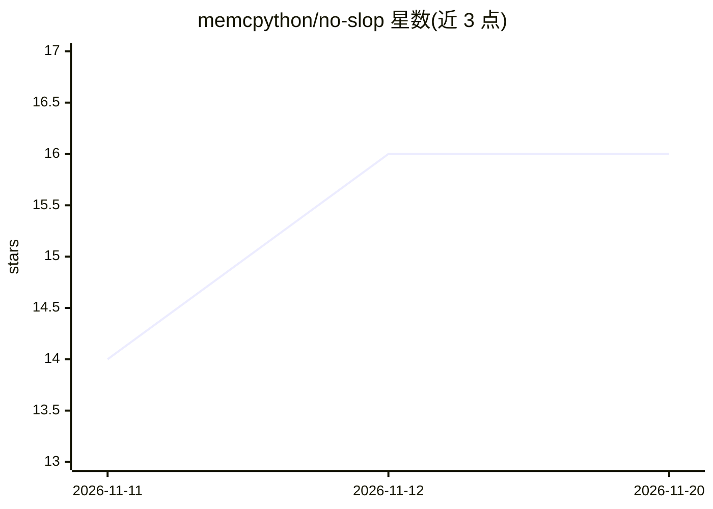

# memcpython/no-slop

⭐ 16 · MIT · 推送 2026-11-11 · [GitHub](https://github.com/memcpython/no-slop) · 个人维护

**给 AI 编程 agent 的行为约束技能文件：先读码后改码**

单文件 SKILL.md 形式的指令型 agent 技能，无运行时、无依赖。内容为一组规则，约束编写、调试、重构或审查代码的 AI agent 的行为：先核查 API 实际契约与安装版本、追溯故障根因、做最小连贯修改、在合理位置处理错误、以测试或复现支撑验证结论并如实报告不确定性。安装方式为将文件放入支持 Agent Skills 格式的 agent（Codex、Claude Code）技能目录。作者自述它不是 linter、安全扫描器或质量基准，效果取决于 agent、项目与任务。

## 筛选速览

| 维度 | 判定 | 备注 |
|---|---|---|
| AI 角色 | `ai-ecosystem` | LLM/agent 周边工具 |
| 许可风险 | `permissive` | MIT |
| 部署形态 | `None` |  |
| 模型依赖 | — | README 未给出锁定关系 |
| 硬件要求 | — | 无带数字的原话,不猜 |
| 安装摩擦 | `low` | 无编译、无系统依赖或容器化 |
| 成熟度 | — | 结构信号不足 |

## 能力要点

- 单文件 SKILL.md，无运行时无依赖
- 规则要求先核查实际契约再做最小修改
- 要求区分证据与假设、报告不确定性
- 支持放入 Codex / Claude Code 技能目录或任何支持 Agent Skills 格式的 agent

## 适用场景

- 约束 AI 编程 agent 减少臆测 API 与过度重写
- 让 agent 的修改附带验证说明而非自称完成
- 团队统一 code agent 的行为规范基线

## 场景标签

`提示工程` · 领域:Agent 开发

## 证据(README 行号)

> L19: One `SKILL.md`. No runtime. No dependencies. Just a set of rules for agents that write, debug, refactor, or review 
> L46: Or install it into any agent that supports the Agent Skills format.

## 星数曲线

2026-11-11 14 → 2026-11-20 16（+2）

---
*卡片 v1 · prompt 1.4 · 生成 2026-11-18 · 置信度 high · 依据 README sha `beb69552d75a` · [字段定义](../../DATASET.md)*
