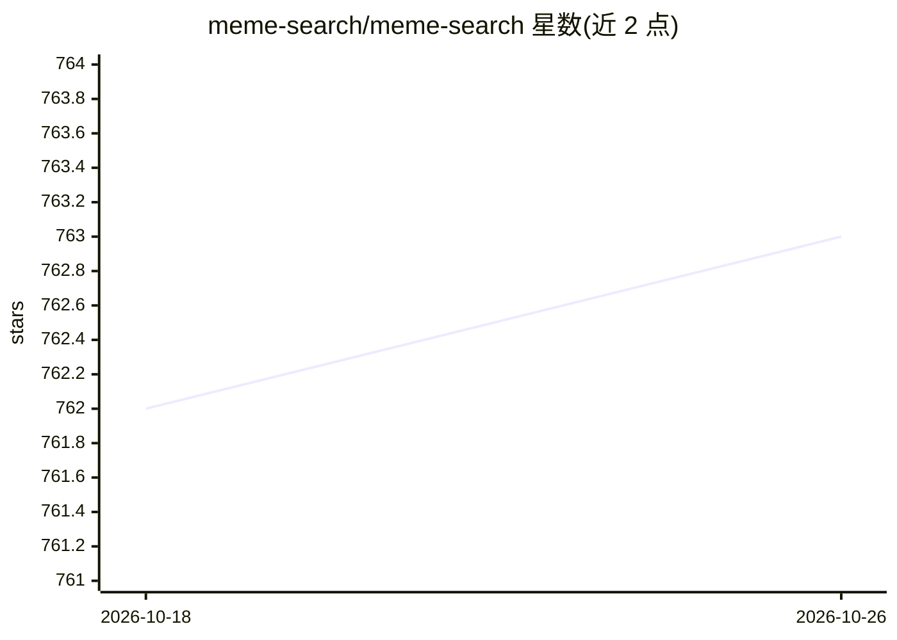

# meme-search/meme-search

⭐ 763 · Ruby · Apache-2.0 · 推送 2026-10-19 · [GitHub](https://github.com/meme-search/meme-search) · [官网](https://meme-search.neonwatty.com/) · 组织维护

**自托管的表情包语义搜索引擎，AI 生成图片描述并支持向量检索**

基于 Rails + Python + Docker 的自托管 meme 搜索引擎：用图像到文本模型（Florence-2、SmolVLM、Moondream2 等六种可选，200M-2B 参数）为图片生成描述，结合 Postgres/pgvector 做关键词与向量语义检索。描述生成默认本地执行，也可切换为 OpenAI 兼容视觉 API（此时嵌入与搜索仍留在本地）。提供 Web 界面（拖拽上传、标签、批量生成、目录重扫）、token 认证的只读 Search API v1、本地 CLI 与实验性 Chromium 弹窗。Web UI 默认绑定 127.0.0.1，不支持直接公网暴露。

## 筛选速览

| 维度 | 判定 | 备注 |
|---|---|---|
| AI 角色 | `ai-native` | 本体是模型或模型工具 |
| 许可风险 | `permissive` | Apache-2.0 |
| 部署形态 | `self-host` | docker 或自建部署 |
| 模型依赖 | — | README 未给出锁定关系 |
| 硬件要求 | `cpu-ok` | |
| 安装摩擦 | `low` | 无编译、无系统依赖或容器化 |
| 成熟度 | `idea` | |

## 能力要点

- 6 种图像到文本模型可选（Florence-2/SmolVLM/Moondream2，含 INT8 量化版供低内存与 CPU 机器）
- 关键词与向量语义搜索，基于 Postgres + pgvector
- 描述生成可全本地或接入 OpenAI 兼容视觉 API（嵌入与搜索始终本地）
- token 认证的只读 Search API v1、无依赖 CLI、拖拽批量上传（50 文件）

## 适用场景

- 把个人 meme 收集目录建成可语义搜索的本地图库
- 用自然语言描述快速找到某张表情包
- 在 homelab/NAS 上自托管，数据不出本机

## 场景标签

`语义搜索` · 领域:知识与检索

## 证据(README 行号)

> L5: Use AI to index your memes by their content and text, making them easily retrievable for your meme warfare pleasures
> L7: By default, processing from image-to-text extraction, to vector embedding, to search is performed locally. You can a
> L228: - `IMAGE_DESCRIPTION_PROVIDER=local` uses the bundled Python `image_to_text_generator` service. This is the defaul

## 星数曲线

2026-10-18 762 → 2026-10-26 763（+1）

---
*卡片 v1 · prompt 1.4 · 生成 2026-10-21 · 置信度 high · 依据 README sha `acd5ff267174` · [字段定义](../../DATASET.md)*
