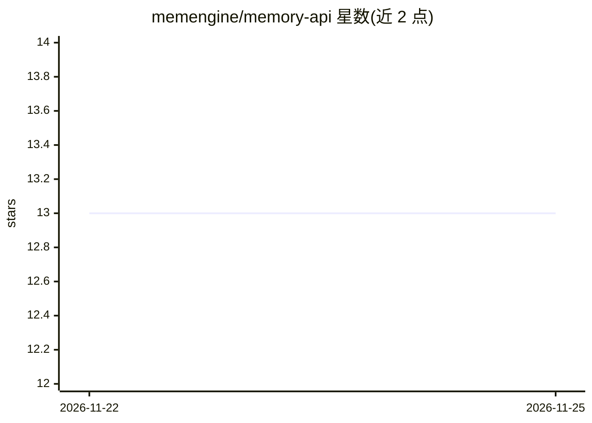

# memengine/memory-api

⭐ 13 · Python · MIT · 推送 2026-11-21 · [GitHub](https://github.com/memengine/memory-api) · [官网](https://memoryo.dev/) · 个人维护

**为 AI agent 提供带来源追踪与更正历史的记忆服务**

MemoryOS 是面向聊天机器人与 agent 开发者的记忆存储服务：保存对话与服务中提取的记录，每条记录携带来源与修订历史；当更正待审核时，应用可在使用相关上下文前感知该状态。提供 Python 与 TypeScript SDK、REST API 文档，附两来源冲突演示、无 key 本地模拟（mock 提取与嵌入）及 LangGraph 示例；Docker beta 需 OPENAI_API_KEY。MIT 许可，招募社区贡献。

## 筛选速览

| 维度 | 判定 | 备注 |
|---|---|---|
| AI 角色 | `ai-ecosystem` | LLM/agent 周边工具 |
| 许可风险 | `permissive` | MIT |
| 部署形态 | `None` |  |
| 模型依赖 | — | README 未给出锁定关系 |
| 硬件要求 | — | 无带数字的原话,不猜 |
| 安装摩擦 | `medium` | 含编译或系统依赖之一 |
| 成熟度 | — | 结构信号不足 |

## 能力要点

- 每条记忆记录携带来源与修订历史，更正待审核状态可被应用读取
- 提供 Python 与 TypeScript SDK 及 API 文档
- 无 key 本地演示：mock 提取与嵌入，无需 API key、容器或付费调用
- 提供 LangGraph 示例

## 适用场景

- 客服 agent 在计划信息被更正待审核时避免使用过时上下文
- 为 chatbot 或 agent 保存并检索对话中的有效信息
- 追踪记忆条目的来源以处理多来源冲突

## 场景标签

`Agent 记忆` · 领域:Agent 开发

## 证据(README 行号)

> L3: **Memory for AI agents that tracks what changed and where it came from.**
> L5: Building a chatbot or agent? Use MemoryOS to save useful information from conversations and services, then fetch the
> L45: Start the API and save a memory with Python or TypeScript, then connect your agent. The Docker beta requires `OPENA

## 星数曲线

2026-11-22 13 → 2026-11-25 13（+0）

---
*卡片 v1 · prompt 1.4 · 生成 2026-11-22 · 置信度 high · 依据 README sha `507e337fdf45` · [字段定义](../../DATASET.md)*
