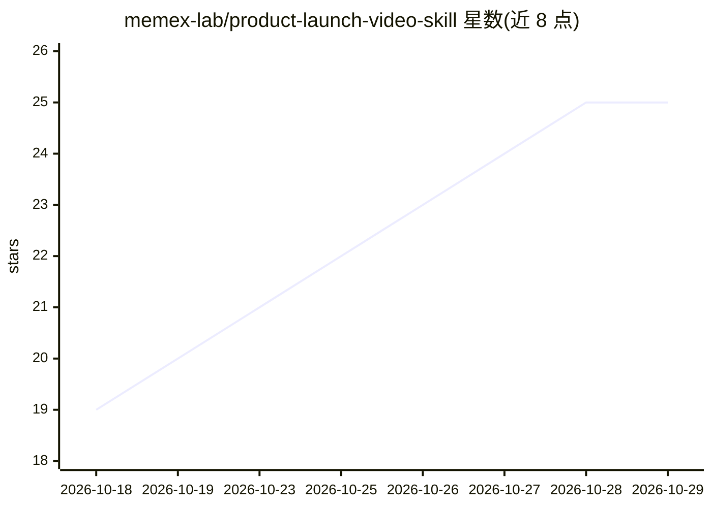

# memex-lab/product-launch-video-skill

⭐ 25 · JavaScript · MIT · 推送 2026-06-01 · [GitHub](https://github.com/memex-lab/product-launch-video-skill) · [官网](https://www.memexlab.ai/) · 组织维护

**让 AI 编码 agent 用 Remotion 制作产品发布视频的技能包**

面向 AI 编码 agent 的技能（SKILL.md）包：主技能 product-launch-video 引导 agent 将产品简报、截图、演示录像或品牌素材转化为分镜、视觉方向明确的 Remotion 发布视频，覆盖理解产品、生成 storyboard.json、帧级动画构建到渲染审查的完整制作流程；另含可选 gemini-tts 参考实现，用脚本生成单句与多段配音（需 Node.js 18+、ffmpeg、GEMINI_API_KEY）。通过 npx skills 安装，最终质量依赖 agent 环境中的图像/视频/音频生成工具。

## 筛选速览

| 维度 | 判定 | 备注 |
|---|---|---|
| AI 角色 | `ai-ecosystem` | LLM/agent 周边工具 |
| 许可风险 | `permissive` | MIT |
| 部署形态 | `library` | 以包/库形式分发 |
| 模型依赖 | — | README 未给出锁定关系 |
| 硬件要求 | — | 无带数字的原话,不猜 |
| 安装摩擦 | `medium` | 含编译或系统依赖之一 |
| 成熟度 | — | 结构信号不足 |

## 能力要点

- 引导 agent 完成分镜(storyboard.json)-实现-渲染审查的完整制作工作流
- 可选 gemini-tts 参考实现：单句与多段配音生成、静音切分与时长报告
- 可替换 TTS 管线（ElevenLabs/OpenAI TTS/本地 TTS 等）

## 适用场景

- 让 AI agent 为我的产品制作预告片或功能发布视频
- 把产品截图与品牌素材转成带配音的动态视频
- 为开发者 API 或应用生成 30-45 秒发布宣传视频

## 场景标签

`视频生成` `语音合成` · 领域:内容生成

## 证据(README 行号)

> L3: Create cinematic product launch videos with an AI coding agent.
> L5: `product-launch-video` helps an agent turn a rough product brief, screenshots, demo recordings, photos, or brand ass

## 星数曲线

2026-10-18 19 → 2026-10-29 25（+6）

---
*卡片 v1 · prompt 1.4 · 生成 2026-10-27 · 置信度 high · 依据 README sha `a773da112cea` · [字段定义](../../DATASET.md)*
