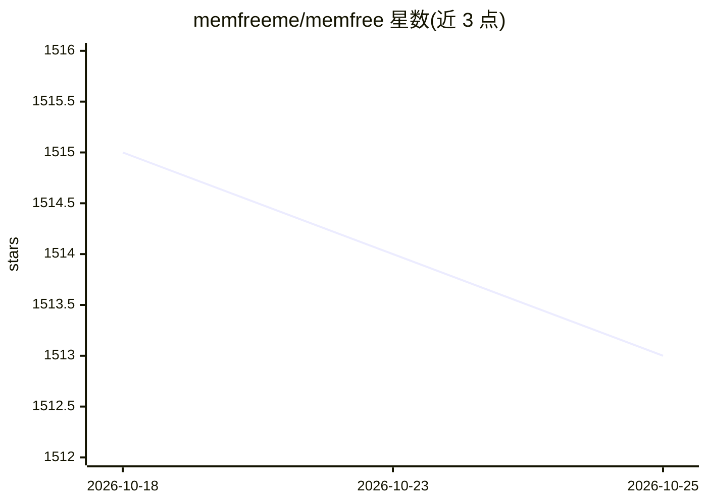

# memfreeme/memfree

⭐ 1,513 · TypeScript · MIT · 推送 2026-07-06 · [GitHub](https://github.com/memfreeme/memfree) · [官网](https://www.memfree.me?ref=github.com) · 组织维护 · 中文 README

**混合 AI 搜索引擎与 AI 页面生成器，面向个人用户**

MemFree 是开源的混合 AI 搜索引擎：从用户个人知识库（本地文件、书签）与互联网同时检索，调用 ChatGPT、Claude、Gemini 等模型生成回答，支持文本/图片/文件/网页多种输入与思维导图等多种呈现；另含 PageGen AI UI 生成器，基于 Claude 3.5 Sonnet 与 React+Tailwind+Shadcn UI 生成可预览、可发布的页面。提供 Chrome 扩展与 Zeabur/Vercel/Netlify/Railway/Fly.io/Cloudflare 一键部署，自托管需 Bun、Upstash Redis、OpenAI 与 Serper API Key。

## 筛选速览

| 维度 | 判定 | 备注 |
|---|---|---|
| AI 角色 | `ai-native` | 本体是模型或模型工具 |
| 许可风险 | `permissive` | MIT |
| 部署形态 | `None` |  |
| 模型依赖 | — | README 未给出锁定关系 |
| 硬件要求 | — | 无带数字的原话,不猜 |
| 安装摩擦 | `low` | 无编译、无系统依赖或容器化 |
| 成熟度 | — | 结构信号不足 |

## 能力要点

- 混合检索：个人知识库（文本/PDF/Docx/PPTX/Markdown）+ 互联网多搜索引擎（Google/Exa/Vector）
- 集成 ChatGPT、Cla、Gemini 多模型与多语言（7 种）支持
- AI UI 生成：文本/图片/文件转 React+Tailwind+Shadcn 页面，实时预览与一键发布
- Chrome 书签一键同步索引与跨设备搜索历史同步

## 适用场景

- 统一搜索自己的笔记、文档、书签与全网内容并获取 AI 总结回答
- 多张图片搜索、对比与总结分析
- 把文字或设计图快速生成可发布的响应式网页
- 自托管部署私有 AI 搜索服务

## 场景标签

`知识库管理` `语义搜索` `代码生成` · 领域:编码与开发

## 证据(README 行号)

> L29: MemFree is a Hybrid AI Search Engine .
> L31: With MemFree, you can instantly get Accurate Answers from your knowledge base and the whole internet.
> L35: Memfree uses the most powerful AI model - Claude 3.5 Sonnet and the most popular front-end framework - React + Tail

## 星数曲线

2026-10-18 1,515 → 2026-10-25 1,513（-2）

---
*卡片 v1 · prompt 1.4 · 生成 2026-10-21 · 置信度 high · 依据 README sha `f4c598ac7ed3` · [字段定义](../../DATASET.md)*
