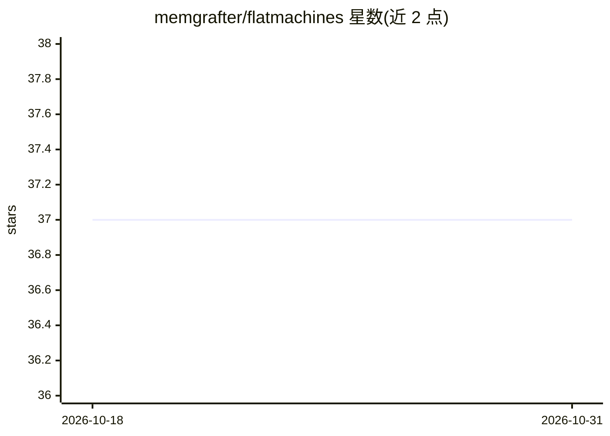

# memgrafter/flatmachines

⭐ 37 · Python · Apache-2.0 · 推送 2026-06-02 · [GitHub](https://github.com/memgrafter/flatmachines) · 个人维护

**用 YAML 状态机网络编排 AI agent 的运行时框架**

开发者用 YAML 描述状态、迁移与 agent，运行时负责重试、并行、检查点/恢复、错误路由与分布式 worker；agent 调用由 profiles.yml 模型目录配置，可自带 CLI 或 agent，也可搭配 flatagents API 使用。持久化/锁/队列后端支持 sqlite/redis/postgres/s3/dynamodb 等多种选项。Python SDK 标记为 Stable，JS 与 Rust SDK 未就绪，README 自带免责声明并建议暂用 Python SDK。

## 筛选速览

| 维度 | 判定 | 备注 |
|---|---|---|
| AI 角色 | `ai-ecosystem` | LLM/agent 周边工具 |
| 许可风险 | `permissive` | Apache-2.0 |
| 部署形态 | `library` | 以包/库形式分发 |
| 模型依赖 | — | README 未给出锁定关系 |
| 硬件要求 | — | 无带数字的原话,不猜 |
| 安装摩擦 | `low` | 无编译、无系统依赖或容器化 |
| 成熟度 | `idea` | |

## 能力要点

- YAML 定义状态机，运行时处理重试/并行/检查点/错误恢复
- 持久化、锁、结果、注册、工作队列等多类可插拔后端（sqlite/redis/postgres/s3/dynamodb 等）
- sdk/examples 内含 20 个可运行示例（writer-critic、分布式 worker、human-in-the-loop 等）
- OpenTelemetry 指标与多格式日志支持

## 适用场景

- 用状态机编排多 agent 工作流而不用重构 Python 代码
- 运行需要检查点与错误恢复的长流程 agent 任务
- 用分布式 worker 池并行执行机器任务

## 场景标签

`多智能体` `Agent 框架` · 领域:Agent 开发

## 证据(README 行号)

> L3: Orchestrate agents with a peer network of state machines. Supports checkpoint/restore, persistence, and more. Batter
> L13: You write YAML that describes states, transitions, and agents. The runtime handles retries, parallelism, checkpoint

## 星数曲线

2026-10-18 37 → 2026-10-31 37（+0）

---
*卡片 v1 · prompt 1.4 · 生成 2026-10-25 · 置信度 high · 依据 README sha `36cd969a7b1c` · [字段定义](../../DATASET.md)*
