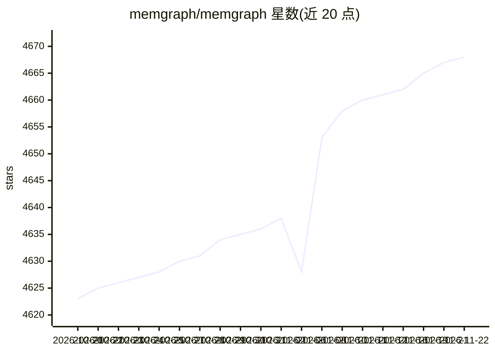

# memgraph/memgraph

⭐ 4,668 · C++ · NOASSERTION · 推送 2026-11-21 · [GitHub](https://github.com/memgraph/memgraph) · [官网](https://memgraph.com) · 组织维护

**面向 GraphRAG、AI 记忆与实时图分析的内存图数据库**

Memgraph 是用 C/C++ 构建的内存图数据库，兼容 Neo4j 的 Cypher 查询语言，支持 ACID 事务。它将向量索引、文本索引与图遍历放在同一查询层，用于 GraphRAG 管道、AI 记忆系统和 agent 工作流；附带 MAGE 算法库（40+ 图算法）、MCP server 与 agent 框架集成组件，并支持 Kafka/Pulsar 流式接入、Kubernetes Helm 部署与高可用、多租户等企业功能。社区版采用 BSL 许可，另有企业版。

## 筛选速览

| 维度 | 判定 | 备注 |
|---|---|---|
| AI 角色 | `ai-ecosystem` | LLM/agent 周边工具 |
| 许可风险 | `none` | NOASSERTION |
| 部署形态 | `library` | 以包/库形式分发 |
| 模型依赖 | — | README 未给出锁定关系 |
| 硬件要求 | — | 无带数字的原话,不猜 |
| 安装摩擦 | `high` | 编译与系统依赖俱全 |
| 成熟度 | — | 结构信号不足 |

## 能力要点

- 内置向量/文本/地理空间索引，混合检索可表达为单条 Cypher 查询
- MAGE 算法库含 40+ C++/Python/CUDA 图算法
- 提供 MCP server、AI Toolkit 及 agent 框架集成组件
- 支持 Kafka/Pulsar/RedPanda 流式摄入与 Helm/Kubernetes 部署

## 适用场景

- 为 RAG 系统提供带向量检索的图上下文存储
- 构建需要长期记忆的 agent 应用
- 实时图分析场景如反欺诈与网络监控
- 从 Kafka 流式数据构建实时知识图谱

## 场景标签

 · 领域:数据库/GraphRAG 基础设施

## 证据(README 行号)

> L26: Memgraph is a high-performance, in-memory graph database that powers real-time
> L28: for GraphRAG pipelines, AI memory systems, and agentic workflows — delivering
> L55: - **AI Toolkit** - Integrations with
> L86: Docker and starts Memgraph with

## 星数曲线

2026-10-20 4,623 → 2026-11-22 4,668（+45）

---
*卡片 v1 · prompt 1.4 · 生成 2026-11-22 · 置信度 high · 依据 README sha `6447cdb1f4f1` · [字段定义](../../DATASET.md)*
