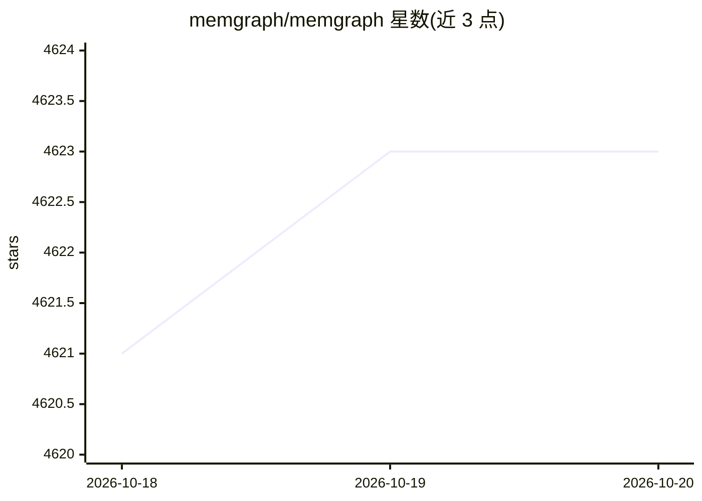

# memgraph/memgraph

⭐ 4,623 · C++ · NOASSERTION · 推送 2026-10-19 · [GitHub](https://github.com/memgraph/memgraph) · [官网](https://memgraph.com) · 组织维护

**内存图数据库：为 GraphRAG 与 AI 记忆提供图检索引擎**

用 C/C++ 构建的内存图数据库，兼容 Neo4j 的 Cypher 查询语言，支持 ACID 与高可用（Raft）。面向 GraphRAG、AI 记忆与 agentic 工作流场景：内置向量与文本索引可在单条查询中完成相似度检索与图遍历，MAGE 算法库提供 40+ 图算法（含 GNN 链接预测），并有 LLM 工具模块、MCP server 与 agent 框架集成。支持 Kafka/Pulsar/RedPanda 流式摄入、Parquet/JSONL 加载、多租户与细粒度权限。社区版采用 BSL 许可，企业版采用 MEL 许可；提供 Docker 镜像、二进制包与 Helm 部署方式。

## 筛选速览

| 维度 | 判定 | 备注 |
|---|---|---|
| AI 角色 | `ai-ecosystem` | LLM/agent 周边工具 |
| 许可风险 | `none` | NOASSERTION |
| 部署形态 | `library` | 以包/库形式分发 |
| 模型依赖 | — | README 未给出锁定关系 |
| 硬件要求 | — | 无带数字的原话,不猜 |
| 安装摩擦 | `high` | 编译与系统依赖俱全 |
| 成熟度 | — | 结构信号不足 |

## 能力要点

- 向量/文本/地理索引与图遍历合并为单条 Cypher 查询的混合检索
- MAGE 算法库含 40+ 图算法（C++/Python/CUDA，含 GNN 链接预测）
- Kafka/Pulsar/RedPanda 流式摄入与实时图算法
- 企业特性：Raft 高可用、多租户、细粒度访问控制、SSO

## 适用场景

- 作为 GraphRAG 管线或 AI 记忆系统的图存储与检索引擎
- 欺诈检测、网络分析等实时图分析工作负载
- 从 Cypher/Neo4j 生态迁移查询负载

## 场景标签

`知识图谱` `RAG` · 领域:知识与检索

## 证据(README 行号)

> L26: Memgraph is a high-performance, in-memory graph database that powers real-time
> L28: for GraphRAG pipelines, AI memory systems, and agentic workflows — delivering
> L55: - **AI Toolkit** - Integrations with

## 星数曲线

2026-10-18 4,621 → 2026-10-20 4,623（+2）

---
*卡片 v1 · prompt 1.4 · 生成 2026-10-20 · 置信度 high · 依据 README sha `1fbfb5792d46` · [字段定义](../../DATASET.md)*
