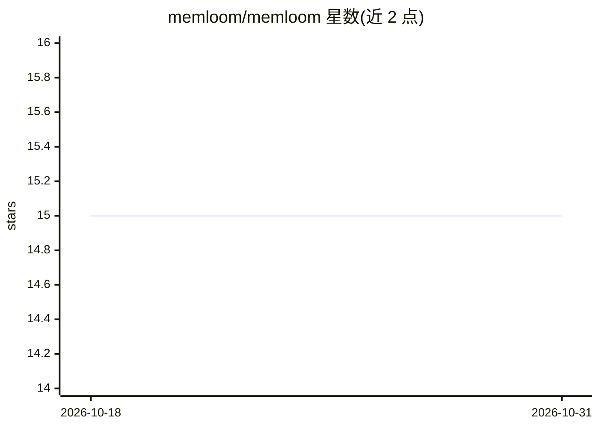

# memloom/memloom

⭐ 15 · TypeScript · Apache-2.0 · 推送 2026-10-27 · [GitHub](https://github.com/memloom/memloom) · [官网](https://memloom.dev) · 个人维护

**面向 AI agent 的本地优先记忆引擎：一个存储跨工具共享**

运行在本机的记忆引擎：单个 daemon 持有一个内嵌 Postgres 存储，CLI、MCP、HTTP、本地 UI 与 Postgres 客户端均访问同一存储，使 Claude Code、Cursor、Copilot 等多个工具共享记忆并跨会话持久。支持矛盾检测与可逆的人工裁决、带引用的召回（定位到章节/页码/时间戳）、导入本地文件与编码会话记录、Notion 同步。检索为向量+关键词+实体图的混合方式，在单条 SQL 中融合。离线可用；嵌入、矛盾检测与实体抽取需配置 OpenRouter API key。要求 Node 20+，无需 Docker。

## 筛选速览

| 维度 | 判定 | 备注 |
|---|---|---|
| AI 角色 | `ai-ecosystem` | LLM/agent 周边工具 |
| 许可风险 | `permissive` | Apache-2.0 |
| 部署形态 | `library` | 以包/库形式分发 |
| 模型依赖 | — | README 未给出锁定关系 |
| 硬件要求 | — | 无带数字的原话,不猜 |
| 安装摩擦 | `low` | 无编译、无系统依赖或容器化 |
| 成熟度 | — | 结构信号不足 |

## 能力要点

- 单 daemon 单存储，CLI/MCP/HTTP/UI/Postgres 多端访问
- 矛盾保留双方并请求人工裁决，每次裁决可逆
- 混合检索：向量+关键词+实体图在单条 SQL 中融合
- 导入会话转录与 agent 记忆文件，带来源追溯

## 适用场景

- 让多个编码 agent 工具共享同一份持久记忆
- 把本地笔记、PDF、网页纳入统一的召回来源
- 审计与纠正 agent 记忆中的错误条目

## 场景标签

`Agent 记忆` · 领域:Agent 开发

## 证据(README 行号)

> L5: **A local-first memory engine for AI agents.** One store on your machine, shared by every tool
> L27: Retrieval is hybrid: vector, keyword and entity-graph arms fused by rank in a single SQL call
> L72:     "memloom": { "command": "npx", "args": ["-y", "@memloom/mcp"] }

## 星数曲线

2026-10-18 15 → 2026-10-31 15（+0）

---
*卡片 v1 · prompt 1.4 · 生成 2026-10-30 · 置信度 high · 依据 README sha `e6db00833566` · [字段定义](../../DATASET.md)*
