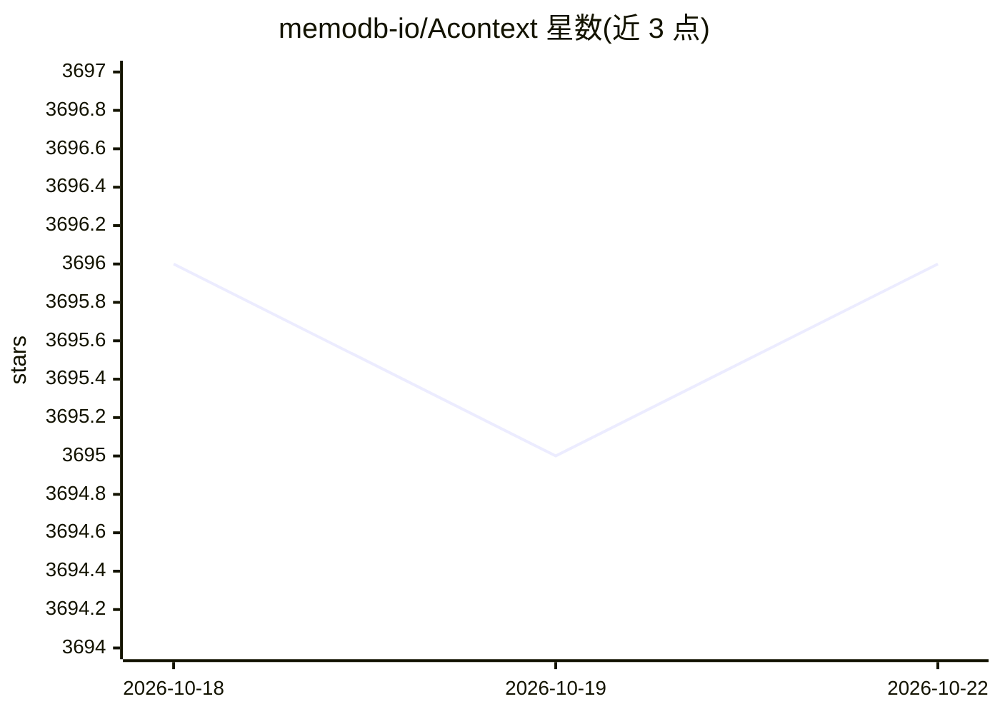

# memodb-io/Acontext

⭐ 3,696 · JavaScript · Apache-2.0 · 推送 2026-07-14 · [GitHub](https://github.com/memodb-io/Acontext) · [官网](https://acontext.io) · 组织维护

**AI agent 的技能记忆层：自动沉淀运行经验为可读技能文件**

面向 agent 开发者的开源记忆层：从会话消息与任务成败中自动蒸馏经验，由 Skill Agent 按 SKILL.md 结构写入 Markdown 技能文件；agent 通过 get_skill 等工具按需读取，不依赖嵌入检索，文件可导出 ZIP 跨框架复用。提供云服务（API Key）与 Docker 自托管后端两种接入方式，维护 Python pypi 与 TypeScript npm SDK，内置沙箱、虚拟磁盘、上下文压缩等功能。默认使用 gpt-4.1 且要求 LLM 支持工具调用，Apache 2.0 许可。

## 筛选速览

| 维度 | 判定 | 备注 |
|---|---|---|
| AI 角色 | `ai-ecosystem` | LLM/agent 周边工具 |
| 许可风险 | `permissive` | Apache-2.0 |
| 部署形态 | `library` | 以包/库形式分发 |
| 模型依赖 | — | README 未给出锁定关系 |
| 硬件要求 | — | 无带数字的原话,不猜 |
| 安装摩擦 | `low` | 无编译、无系统依赖或容器化 |
| 成熟度 | — | 结构信号不足 |

## 能力要点

- 会话消息→任务结局→蒸馏→Skill Agent 的自动技能沉淀流水线
- 记忆以 Markdown 技能文件存储，可读取、编辑、导出 ZIP 跨框架复用
- 渐进式披露检索：agent 通过 get_skill/get_skill_file 工具取用，无嵌入检索
- 提供 Docker 自托管后端（acontext-cli）与 Python/TypeScript SDK

## 适用场景

- 让自建 agent 从任务成败中积累可审计的经验技能
- 跨 agent/框架共享和复用记忆技能文件
- 需要私有化部署的 agent 记忆与沙箱执行环境

## 场景标签

`Agent 记忆` · 领域:Agent 开发

## 证据(README 行号)

> L14: Acontext is an open-source skill memory layer for AI agents. It **automatically** captures learnings from agent run
> L27: - **Plain file, any framework** — Skill memories are Markdown files. Use them with LangGraph, Claude, AI SDK, or an

## 星数曲线

2026-10-18 3,696 → 2026-10-22 3,696（+0）

---
*卡片 v1 · prompt 1.4 · 生成 2026-10-21 · 置信度 high · 依据 README sha `0e23774ba9fb` · [字段定义](../../DATASET.md)*
