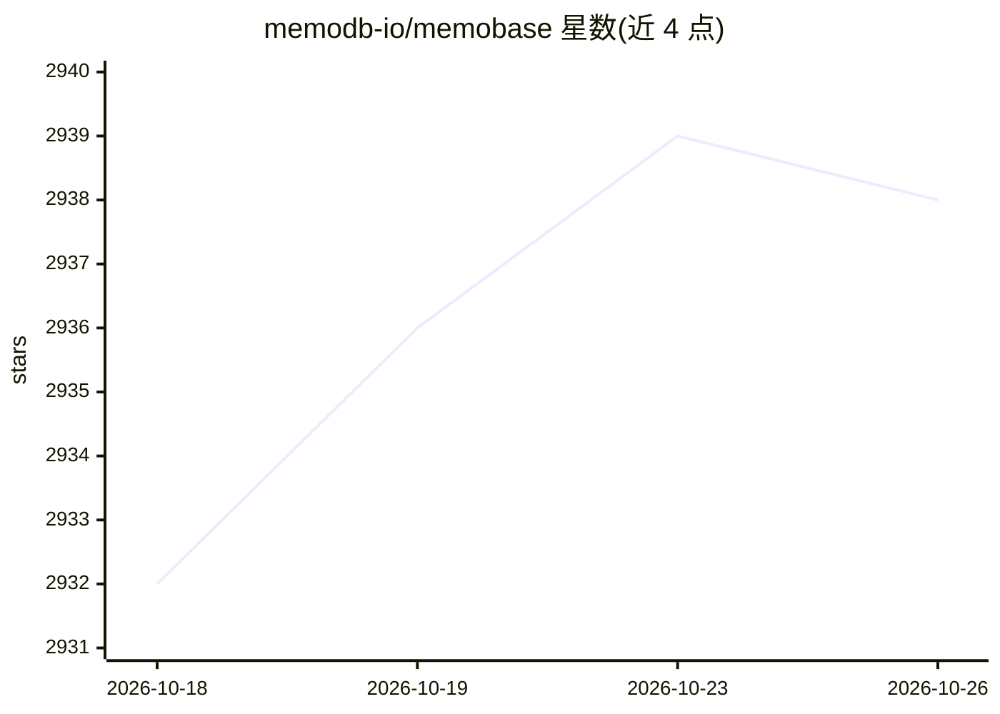

# memodb-io/memobase

⭐ 2,938 · Python · Apache-2.0 · 推送 2026-01-11 · [GitHub](https://github.com/memodb-io/memobase) · [官网](https://memobase.io) · 组织维护

**面向 LLM 应用的用户画像式长期记忆系统**

为聊天类 LLM 应用提供基于用户画像的长期记忆：以 blob 形式插入用户聊天数据，经每用户缓冲区批量处理后抽取为结构化画像与事件时间线，提供 context API 将记忆打包进提示词。服务端基于 FastAPI、Postgres、Redis，支持 Docker 部署，提供 Python/Node/Go SDK 与 MCP 接入，亦有托管云服务与免费 Playground。画像结构与捕获内容可配置，官方称在线延迟低于 100ms、固定 3 次 LLM 调用。

## 筛选速览

| 维度 | 判定 | 备注 |
|---|---|---|
| AI 角色 | `ai-ecosystem` | LLM/agent 周边工具 |
| 许可风险 | `permissive` | Apache-2.0 |
| 部署形态 | `library` | 以包/库形式分发 |
| 模型依赖 | local-ok | 支持本地模型 |
| 硬件要求 | — | 无带数字的原话,不猜 |
| 安装摩擦 | `low` | 无编译、无系统依赖或容器化 |
| 成熟度 | — | 结构信号不足 |

## 能力要点

- 每用户缓冲区批量处理聊天并抽取结构化画像（topic/sub_topic/content）
- context API 将记忆打包为字符串直接插入提示词
- 服务端基于 FastAPI/Postgres/Redis，支持 Docker 部署
- 提供 Python/Node/Go SDK、MCP 接入及托管云服务

## 适用场景

- 让 AI 陪伴或助手类应用记住用户的背景与偏好
- 将用户画像注入系统提示词实现个性化对话
- 基于对话中抽取的画像做用户偏好分析与追踪

## 场景标签

`Agent 记忆` · 领域:Agent 开发

## 证据(README 行号)

> L42: Memobase is a **user profile-based memory system** designed to bring long-term user memory to your LLM applications
> L90: Minimal code changes to integrate with your existing LLM stack with API, Python/Node/Go SDK.
> L98: Memobase is building with FastAPI, Postgres and Redis, supporting request caching, authing, telemetry... Fully dock

## 星数曲线

2026-10-18 2,932 → 2026-10-26 2,938（+6）

---
*卡片 v1 · prompt 1.4 · 生成 2026-10-21 · 置信度 high · 依据 README sha `eb1c04318c17` · [字段定义](../../DATASET.md)*
