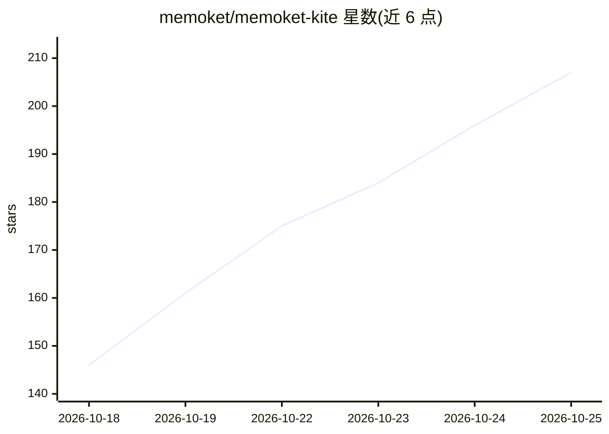

# memoket/memoket-kite

⭐ 213 · Python · Apache-2.0 · 推送 2026-10-12 · [GitHub](https://github.com/memoket/memoket-kite) · [官网](https://memoket.ai) · 组织维护

**AI agent 的向量无关长期记忆引擎，带证据溯源**

面向 AI agent 的长期记忆 Python 库：将对话抽取为带类型、日期与主题索引的结构化事实，把问题编译为可读、可缓存、可校验的符号查询计划（关键词/关联/条件过滤），返回答案时附上原始消息出处；记忆不存在时返回空并声明。运行时不使用 embeddings 与向量数据库，数据存于可移植的主题索引文件。依赖 OpenAI 兼容 LLM 端点（默认 gpt-4.1-mini）完成抽取与阅读。基准：LoCoMo 93.51%、LongMemEval-S 85.60%，平均每问阅读上下文约 1.6K tokens。Apache 2.0 许可，背后有商业产品 Memoket。

## 筛选速览

| 维度 | 判定 | 备注 |
|---|---|---|
| AI 角色 | `ai-ecosystem` | LLM/agent 周边工具 |
| 许可风险 | `permissive` | Apache-2.0 |
| 部署形态 | `library` | 以包/库形式分发 |
| 模型依赖 | — | README 未给出锁定关系 |
| 硬件要求 | — | 无带数字的原话,不猜 |
| 安装摩擦 | `low` | 无编译、无系统依赖或容器化 |
| 成熟度 | — | 结构信号不足 |

## 能力要点

- 对话→带来源链接的结构化事实，主题治理与时间感知检索
- 问题编译为可读的符号查询计划，检索过程可审计
- 无向量栈：不依赖 embeddings 与向量数据库，单一可移植文件存储
- 记忆缺失时明确返回空而非近似匹配；提供基准复现契约与本地 manifest 校验

## 适用场景

- 为对话式 agent 接入可解释、可溯源的长期记忆
- 需要按时间处理'现在是谁/最新状态'类问题的记忆检索
- 要求回答附带'谁说的、何时、原话'证据的场景

## 场景标签

`Agent 记忆` · 领域:Agent 开发

## 证据(README 行号)

> L204: KITE by Memoket is a plain Python library: three calls take you from a raw conversation
> L5: Open-source and vector-free, KITE achieves **🥇 93.51% on LoCoMo and 🥇 85.60% on LongMemEval-S**, with *gpt-4.1-mini*
> L218: **The memory you just read about ships today.** KITE is the algorithm inside

## 星数曲线

2026-10-18 146 → 2026-10-25 207（+61）

---
*卡片 v1 · prompt 1.4 · 生成 2026-10-22 · 置信度 high · 依据 README sha `314a20a8ad91` · [字段定义](../../DATASET.md)*
