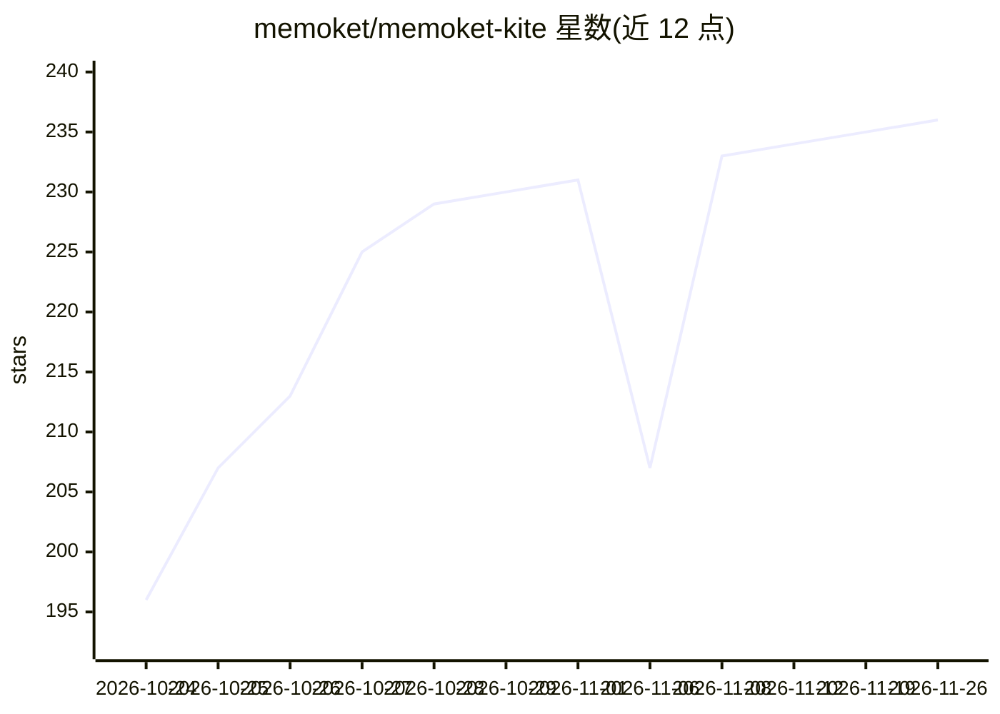

# memoket/memoket-kite

⭐ 236 · Python · Apache-2.0 · 推送 2026-11-18 · [GitHub](https://github.com/memoket/memoket-kite) · [官网](https://memoket.ai) · 组织维护

**给 AI agent 提供无向量的长期记忆引擎库**

以 Python 库形式提供的长期对话记忆引擎：将对话提炼为带类型、日期、主题索引且附原文出处的结构化事实，问题被编译为可读、可验证、可缓存的符号化检索计划，执行后返回带来源链接的答案；无结果时明确返回空。检索基于主题索引与条件过滤，全程不使用 embedding 与向量数据库，并支持时间感知（如“现在”按最新事件排序）。提供 MCP server 可选组件，可接入 Claude Code；基准结果声称可由脚本按复现契约在本地重建。

## 筛选速览

| 维度 | 判定 | 备注 |
|---|---|---|
| AI 角色 | `ai-ecosystem` | LLM/agent 周边工具 |
| 许可风险 | `permissive` | Apache-2.0 |
| 部署形态 | `library` | 以包/库形式分发 |
| 模型依赖 | — | README 未给出锁定关系 |
| 硬件要求 | — | 无带数字的原话,不猜 |
| 安装摩擦 | `low` | 无编译、无系统依赖或容器化 |
| 成熟度 | — | 结构信号不足 |

## 能力要点

- 对话→结构化事实：带类型、日期、主题索引并保留原文证据
- 问题→符号化检索计划：可读、可验证、可缓存，无向量栈
- 答案附来源链接（谁在何时说了什么），无结果时返回明确空
- 可选 MCP server（memoket-kite[mcp]）接入 Claude Code

## 适用场景

- 为聊天机器人或 agent 添加可溯源的长期记忆
- 需要时间敏感问答（如'现在谁负责某客户'）的记忆检索
- 在 Claude Code 中通过 MCP 读取带出处的记忆事实

## 场景标签

`Agent 记忆` · 领域:Agent 开发

## 证据(README 行号)

> L19: - **[2026-08-13]**: 🎉 First public release: **KITE v0.1.0** is open source under Apache-2.0 and on **PyPI** as `mem
> L212: KITE by Memoket is a plain Python library: three calls take you from a raw conversation

## 星数曲线

2026-10-24 196 → 2026-11-26 236（+40）

---
*卡片 v1 · prompt 1.4 · 生成 2026-11-25 · 置信度 high · 依据 README sha `793c26224bf1` · [字段定义](../../DATASET.md)*
