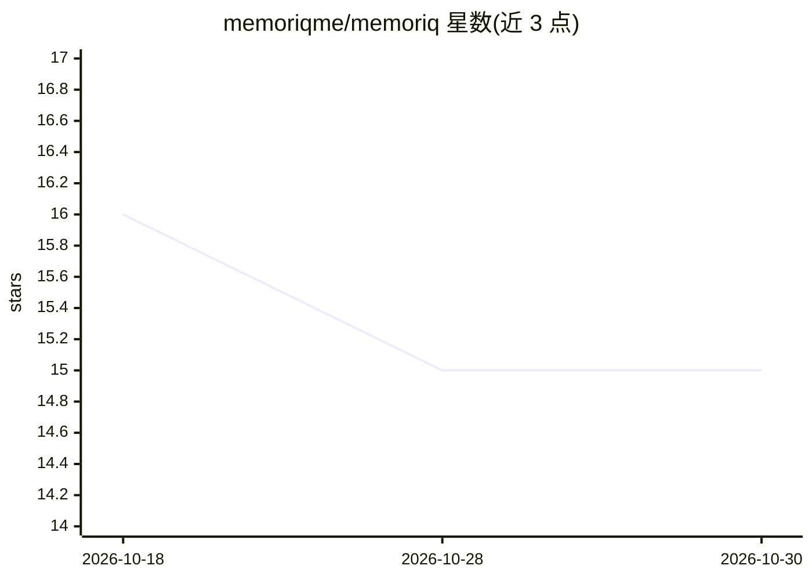

# memoriqme/memoriq

⭐ 15 · Vue · NOASSERTION · 推送 2026-09-03 · [GitHub](https://github.com/memoriqme/memoriq) · [官网](https://memoriq.me) · 组织维护

**端到端加密的 AI 对话存档库：保存并检索多家聊天记录**

Laravel+Vue 的 Web 应用，配套 Chrome 扩展从 ChatGPT、Claude、Gemini、Grok 页面提取对话，在浏览器端用本地主密钥加密标题、正文、元数据后仅上传密文，服务器不存储明文。支持项目组织、解锁后浏览器端搜索、手动粘贴保存、加密备份导入导出；本版本不保留图片音视频。忘记加密密码与恢复密钥则无法找回数据。可自托管，AGPLv3 许可。

## 筛选速览

| 维度 | 判定 | 备注 |
|---|---|---|
| AI 角色 | `ai-enhanced` | 去掉 AI 部分产品仍成立 |
| 许可风险 | `none` | NOASSERTION |
| 部署形态 | `library` | 以包/库形式分发 |
| 模型依赖 | — | README 未给出锁定关系 |
| 硬件要求 | — | 无带数字的原话,不猜 |
| 安装摩擦 | `low` | 无编译、无系统依赖或容器化 |
| 成熟度 | `idea` | |

## 能力要点

- 浏览器端加密后仅上传密文，服务器不存明文
- Chrome 扩展从 ChatGPT/Claude/Gemini/Grok 捕获对话
- 加密 vault 备份的导出与导入
- 支持手动粘贴保存与解锁后浏览器端搜索

## 适用场景

- 跨多个 AI 平台长期保存有价值的对话
- 按项目整理法律笔记、产品想法等 AI 聊天产出
- 自托管保存 AI 对话且不向服务方暴露明文

## 场景标签

`知识库管理` · 领域:知识与检索

## 证据(README 行号)

> L3: Memoriq is a private AI memory vault for saving useful conversations from ChatGPT, Claude, Gemini, and Grok.
> L37: - Saves AI conversations from ChatGPT, Claude, Gemini, and Grok through a browser extension.
> L48: Memoriq is designed so the server does not receive plaintext chat content or user-visible metadata.

## 星数曲线

2026-10-18 16 → 2026-10-30 15（-1）

---
*卡片 v1 · prompt 1.4 · 生成 2026-10-30 · 置信度 mid · 依据 README sha `9181e99995af` · [字段定义](../../DATASET.md)*
