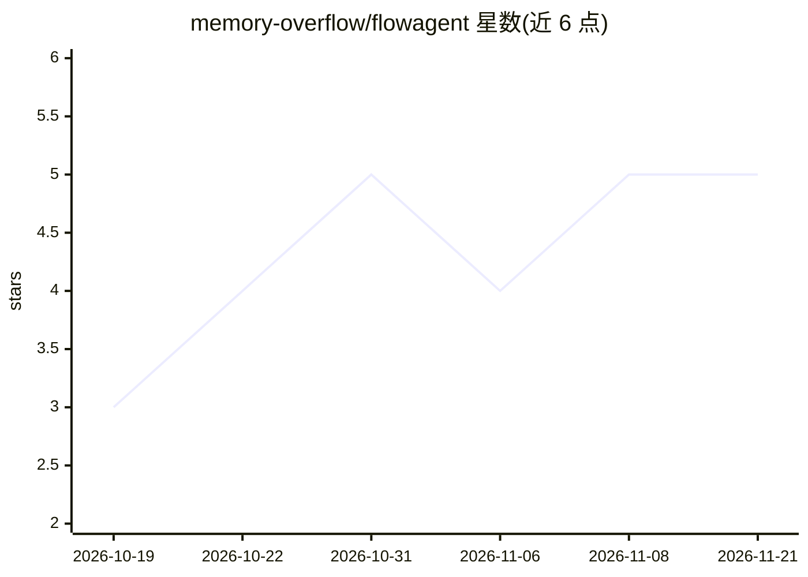

# memory-overflow/flowagent

⭐ 5 · Go · MIT · 推送 2026-11-11 · [GitHub](https://github.com/memory-overflow/flowagent) · 组织维护 · 中文 README

**对话驱动的 Agent 工作流编排框架：聊天转并行 DAG 任务图**

flowagent 将自然语言对话规划为带依赖关系的 DAG 子任务图并并行执行，内置 MCP 工具协议（stdio/SSE/streamable_http 传输）、技能系统（docx/pptx/shell 及第三方技能）与上下文工程（压缩、索引、召回）。提供两种用法：自带 Web UI（聊天、DAG 可视化、模型配置、MCP/技能管理），或通过 HTTP API 作为核心 agent 引擎集成。支持 SSE 流式输出、完整执行轨迹调试与可插拔搜索引擎。Go + React 实现，SQLite 零依赖配置。

## 筛选速览

| 维度 | 判定 | 备注 |
|---|---|---|
| AI 角色 | `ai-ecosystem` | LLM/agent 周边工具 |
| 许可风险 | `permissive` | MIT |
| 部署形态 | `library` | 以包/库形式分发 |
| 模型依赖 | — | README 未给出锁定关系 |
| 硬件要求 | — | 无带数字的原话,不猜 |
| 安装摩擦 | `low` | 无编译、无系统依赖或容器化 |
| 成熟度 | — | 结构信号不足 |

## 能力要点

- 自然语言请求规划为 DAG 并并行执行子任务
- MCP 工具协议集成外部工具（stdio/SSE/streamable_http）
- 两种用法：内置 Web UI 或作为 agent 引擎通过 HTTP API 驱动
- 完整执行轨迹：规划思路、工具调用记录、上下文用量、pprof 性能分析

## 适用场景

- 将长周期任务拆解为并行子任务图加速执行
- 为自有项目集成可对话驱动的 agent 内核
- 通过 Web UI 配置模型、MCP 服务器与技能并可视化工作流

## 场景标签

`Agent 框架` · 领域:Agent 开发

## 证据(README 行号)

> L5: A conversation-driven workflow orchestration framework — turn natural-language conversations into parallel DAG task 
> L73: 1. **An easy-to-integrate, feature-complete open-source agent framework is missing.** Today there is no great open-
> L79: - **Conversation → DAG planning**: plan a natural-language request into a directed acyclic graph (DAG) of sub-tasks

## 星数曲线

2026-10-19 3 → 2026-11-21 5（+2）

---
*卡片 v1 · prompt 1.4 · 生成 2026-11-21 · 置信度 mid · 依据 README sha `1d2d41978608` · [字段定义](../../DATASET.md)*
