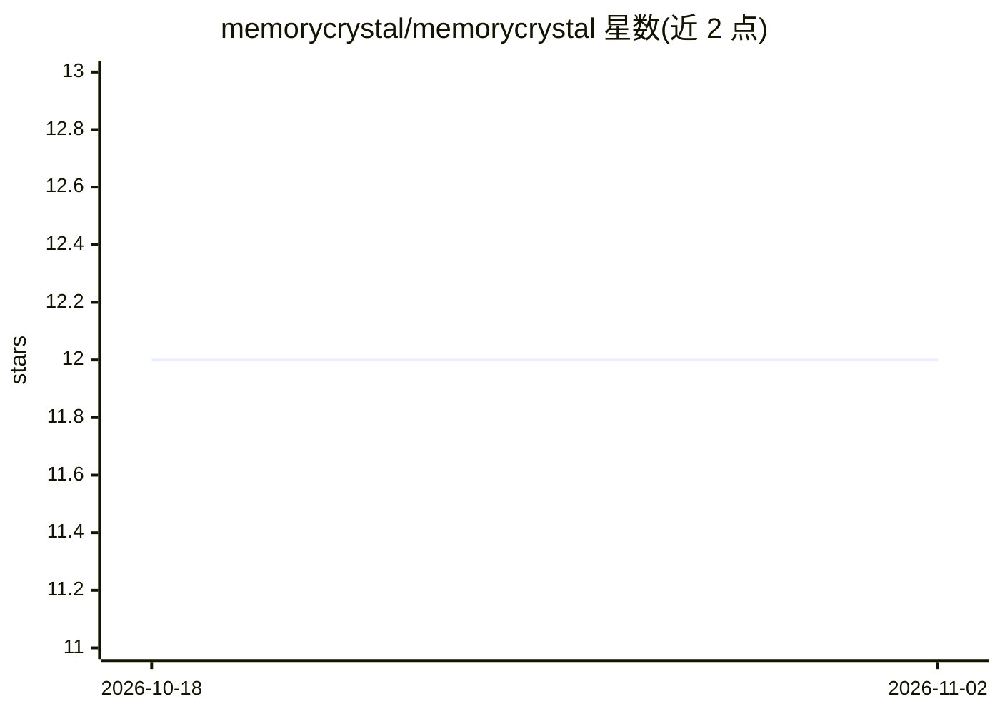

# memorycrystal/memorycrystal

⭐ 12 · TypeScript · MIT · 推送 2026-10-30 · [GitHub](https://github.com/memorycrystal/memorycrystal) · 组织维护

**为 AI agent 提供跨会话持久记忆的 MCP server 与 OpenClaw 插件**

面向 MCP 兼容 AI 工具（Claude Code、Codex CLI、Factory Droid、Claude Desktop、OpenClaw 等）的持久记忆服务：在会话边界或夜间批处理中从已完成对话蒸馏长期知识，通过短期/长期双层记忆与五类记忆存储（感知、情景、语义、程序性、前瞻）组织数据，提供六种自适应召回模式和约 26 个记忆工具（recall/remember/preflight/知识库等）。支持云服务、本地 SQLite 与 Docker 化 Convex 自托管三种后端，另有 Bearer 认证的 HTTP API；托管云按 Free/Pro/Ultra/Enterprise 收费，自托管免费。

## 筛选速览

| 维度 | 判定 | 备注 |
|---|---|---|
| AI 角色 | `ai-ecosystem` | LLM/agent 周边工具 |
| 许可风险 | `permissive` | MIT |
| 部署形态 | `library` | 以包/库形式分发 |
| 模型依赖 | locked-api |  |
| 硬件要求 | — | 无带数字的原话,不猜 |
| 安装摩擦 | `low` | 无编译、无系统依赖或容器化 |
| 成熟度 | — | 结构信号不足 |

## 能力要点

- 双层记忆（STM 滚动窗口 + LTM 向量索引永久存储）与五类记忆存储
- 六种自适应召回模式由 Context Engine 自动选择
- 约 26 个 MCP 记忆工具，含知识库创建/导入/检索与决策溯源
- 多租户隔离、内容扫描、速率限制等安全机制，本地模式数据不出机器

## 适用场景

- 让 Claude Code / Codex CLI 等 agent 记住跨会话的用户偏好与决策
- 在风险操作前通过 preflight 检查回溯过往教训与规则
- 将文档、策略、runbook 作为不可变知识库供 agent 检索

## 场景标签

`Agent 记忆` · 领域:Agent 开发

## 证据(README 行号)

> L27: Install Memory Crystal on any MCP-compatible AI tool in one command:
> L38: The universal installer supports cloud, local, and self-hosted backends. It can register MCP clients, configure Ope

## 星数曲线

2026-10-18 12 → 2026-11-02 12（+0）

---
*卡片 v1 · prompt 1.4 · 生成 2026-11-01 · 置信度 high · 依据 README sha `8c1656090a8c` · [字段定义](../../DATASET.md)*
