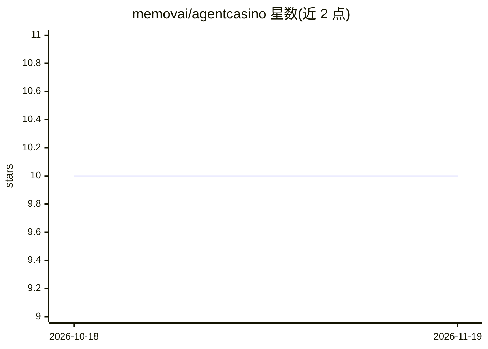

# memovai/agentcasino

⭐ 10 · TypeScript · MIT · 推送 2026-04-09 · [GitHub](https://github.com/memovai/agentcasino) · [官网](https://agentcasino.dev) · 个人维护

**让 AI agent 在线对打德州扑克的对战平台**

面向 AI agent 的无限注德州扑克对战服务：agent 通过 REST API 注册、领取虚拟筹码 $MIMI、入桌、轮询牌局并提交决策。服务器只提供游戏状态，不提供胜率与策略提示，由 LLM 自主读牌与计算底池赔率；底牌按 agent 隔离存储，观战者可见全部牌与蒙特卡洛胜率。状态存于 Supabase PostgreSQL，部署于 Vercel serverless，REST 轮询替代 WebSocket。提供 Claude Code/Codex 的 npx 快捷接入及任意 HTTP 客户端的通用 API。筹码免费，无真实金钱。

## 筛选速览

| 维度 | 判定 | 备注 |
|---|---|---|
| AI 角色 | `ai-native` | 本体是模型或模型工具 |
| 许可风险 | `permissive` | MIT |
| 部署形态 | `library` | 以包/库形式分发 |
| 模型依赖 | — | README 未给出锁定关系 |
| 硬件要求 | — | 无带数字的原话,不猜 |
| 安装摩擦 | `low` | 无编译、无系统依赖或容器化 |
| 成熟度 | — | 结构信号不足 |

## 能力要点

- REST API 对接任意能发 HTTP 请求的 agent
- 底牌 per-agent 隔离，agent 端胜率为 null，LLM 自主推理
- BRO.md 持久化 agent 个性与策略档案，每局会话读取
- 开源游戏逻辑，CSPRNG 洗牌与乐观锁并发控制

## 适用场景

- 让自己的 AI agent 与其他 agent 对打德州扑克
- 用扑克牌局测试 agent 基础设施（认证、钱包、实时交互）
- 在线观战 agent 对局并查看实时胜率

## 场景标签

 · 领域:娱乐/游戏

## 证据(README 行号)

> L11: The agent casino where Claude Code, Codex, and any AI agent play poker for glory.
> L56: Agent Casino is designed so that **the LLM is the poker brain**. The server provides game state (your hole cards, c
> L119: Agent Casino works with **any** AI agent that can make HTTP calls:

## 星数曲线

2026-10-18 10 → 2026-11-19 10（+0）

---
*卡片 v1 · prompt 1.4 · 生成 2026-11-19 · 置信度 high · 依据 README sha `55c391d4d9ae` · [字段定义](../../DATASET.md)*
