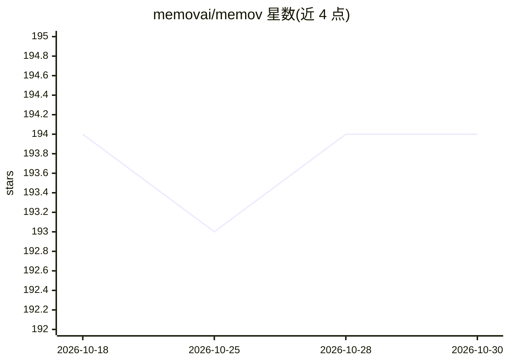

# memovai/memov

⭐ 194 · Python · MIT · 推送 2026-02-05 · [GitHub](https://github.com/memovai/memov) · [官网](https://memov.ai) · 组织维护

**给 AI 编码 agent 提供类 Git 可追溯记忆的 MCP 工具**

面向 AI 编码代理的记忆层，通过 MCP 服务器接入 Claude Code、Codex、VS Code、Cursor 等客户端。核心是 VibeGit 机制：在 git commit 之前自动记录提示词、上下文与代码差异，存入影子 .mem 时间线，不污染原 .git 仓库；支持分支探索、回滚保留历史与跨会话操作。以 uvx 从 git 仓库安装 MCP 服务器，另提供 mem CLI 的安装脚本、Homebrew/APT/YUM 包与二进制下载；可选 [rag] 附加组件启用 VectorDB 语义搜索与提交校验工具，本地运行无需数据库。RAG 模式标注为 WIP。

## 筛选速览

| 维度 | 判定 | 备注 |
|---|---|---|
| AI 角色 | `ai-ecosystem` | LLM/agent 周边工具 |
| 许可风险 | `permissive` | MIT |
| 部署形态 | `desktop` | 安装包/桌面程序 |
| 模型依赖 | locked-api |  |
| 硬件要求 | — | 无带数字的原话,不猜 |
| 安装摩擦 | `low` | 无编译、无系统依赖或容器化 |
| 成熟度 | `idea` | |

## 能力要点

- VibeGit：在 git commit 前自动追踪提示词、上下文与代码差异
- 影子 .mem 时间线，零污染原 .git 仓库，回滚保留全部历史
- 聊天中说 use mem ui 即可打开 localhost:38888 的可视化时间线界面
- 可选 [rag] 附加组件提供语义搜索与提交对齐校验

## 适用场景

- 在 Cursor/Claude Code 等 agent 中回放与回滚任意历史交互
- 跨会话追溯某次代码改动对应的提示词与上下文
- 对 AI 编码会话做语义搜索与提交质量校验

## 场景标签

`Agent 记忆` · 领域:Agent 开发

## 证据(README 行号)

> L14: MemoV is a memory layer for AI coding agents that provides **traceable**, **Git-powered** version control for promp
> L28: - **One-click MCP**: Works with any AI coding agent
> L224: MemoV follows a three-tier architecture with MemovManager as the central orchestrator, the MCP Server as an adapte

## 星数曲线

2026-10-18 194 → 2026-10-30 194（+0）

---
*卡片 v1 · prompt 1.4 · 生成 2026-10-22 · 置信度 mid · 依据 README sha `d969628e367e` · [字段定义](../../DATASET.md)*
