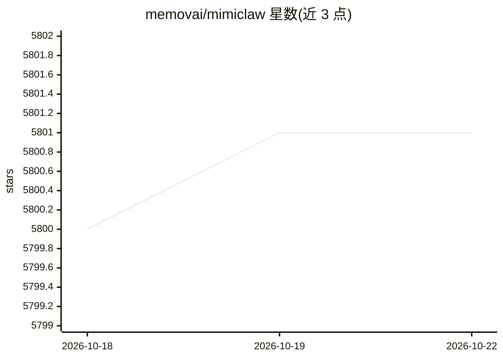

# memovai/mimiclaw

⭐ 5,801 · C · MIT · 推送 2026-10-04 · [GitHub](https://github.com/memovai/mimiclaw) · [官网](https://mimiclaw.io) · 组织维护 · 中文 README

**跑在 5 美元 ESP32-S3 芯片上的 Telegram 个人 AI 助手**

用纯 C（ESP-IDF）实现、运行于单块 ESP32-S3 开发板的个人 AI 助手：无操作系统、无 Node.js，通过 Telegram 收发消息，接入 Anthropic (Claude) 或 OpenAI (GPT) 作为 LLM 供应方（运行时可切换），以 ReAct 循环调用工具（web_search、cron 调度、时钟设置）。记忆以纯文本文件（SOUL.md/MEMORY.md/HEARTBEAT.md 等）存于本地 flash，支持跨重启长期记忆、AI 自建 cron 任务与 Heartbeat 主动任务检查，另有 WebSocket 网关与 OTA 升级。面向愿意刷固件的开发者/爱好者，需 ESP-IDF v5.5+ 环境编译烧录，依赖云端 LLM API key 与 Telegram bot token。

## 筛选速览

| 维度 | 判定 | 备注 |
|---|---|---|
| AI 角色 | `ai-native` | 本体是模型或模型工具 |
| 许可风险 | `permissive` | MIT |
| 部署形态 | `None` |  |
| 模型依赖 | locked-api |  |
| 硬件要求 | — | 无带数字的原话,不猜 |
| 安装摩擦 | `medium` | 含编译或系统依赖之一 |
| 成熟度 | — | 结构信号不足 |

## 能力要点

- 纯 C 实现，无 Linux/Node.js，运行于 $5 ESP32-S3 板（16MB flash / 8MB PSRAM）
- Anthropic 与 OpenAI 双供应方，运行时可切换，均支持工具调用（ReAct 循环）
- 纯文本本地记忆体系（SOUL/USER/MEMORY/HEARTBEAT.md），跨重启持久化
- AI 可自建 cron 定时任务 + Heartbeat 周期性自主执行待办

## 适用场景

- 用一块 ESP32-S3 板搭 24/7 常驻的 Telegram 个人助手
- 让 AI 自主定时执行提醒、每日总结等周期任务
- 在本地 flash 上保存助手人格与长期记忆，数据不离开设备（LLM 调用除外）

## 场景标签

`AI 助手` · 领域:对话与助手

## 证据(README 行号)

> L14: MimiClaw turns a tiny ESP32-S3 board into a personal AI assistant. Plug it into USB power, connect to WiFi, and tal
> L26: You send a message on Telegram. The ESP32-S3 picks it up over WiFi, feeds it into an agent loop — the LLM thinks, c

## 星数曲线

2026-10-18 5,800 → 2026-10-22 5,801（+1）

---
*卡片 v1 · prompt 1.4 · 生成 2026-10-20 · 置信度 high · 依据 README sha `c1726d429434` · [字段定义](../../DATASET.md)*
