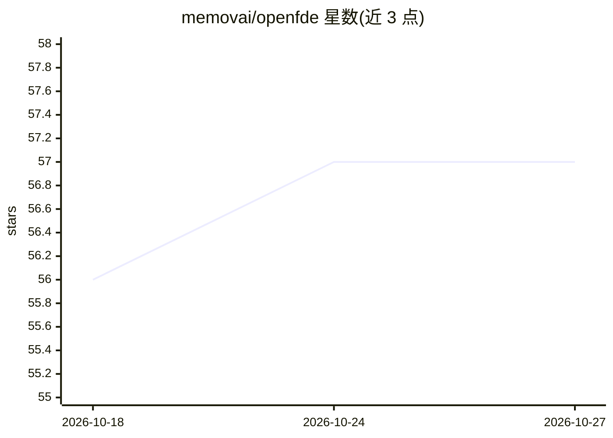

# memovai/openfde

⭐ 57 · TypeScript · MIT · 推送 2026-09-11 · [GitHub](https://github.com/memovai/openfde) · [官网](https://fde.md) · 组织维护

**面向前置部署工程师的本地优先 AI 工作台：访谈变记忆、记忆变任务、任务派给编码 agent**

OpenFDE 将客户访谈、聊天记录、文档、PDF 与图片编译为基于本体（ontology）的可溯运营记忆，存于本地 SQLite 目录；每条事实强制带来源 URI。闭环 agent 运作：编码 agent（如 Claude Code/Codex）通过 CLI 认领任务、拉取带引用的上下文包、在独立 git worktree 中执行并写回结果，任务由状态机与审计轨迹把关。读路径无 LLM，采用 BM25 与实体图扩展加倒数排名融合的混合检索；写路径由固定领域本体约束抽取。附带本地 Web 工作区（笔记/本体/看板/画布四标签页）、自动 mermaid 流程图、高管实时报告与只读局域网分享。

## 筛选速览

| 维度 | 判定 | 备注 |
|---|---|---|
| AI 角色 | `ai-ecosystem` | LLM/agent 周边工具 |
| 许可风险 | `permissive` | MIT |
| 部署形态 | `library` | 以包/库形式分发 |
| 模型依赖 | — | README 未给出锁定关系 |
| 硬件要求 | — | 无带数字的原话,不猜 |
| 安装摩擦 | `low` | 无编译、无系统依赖或容器化 |
| 成熟度 | — | 结构信号不足 |

## 能力要点

- 本体约束的抽取与写入时校验，事实强制带来源 URI
- agent-pull 与 orchestrated 两种任务派发模式，共享任务状态机与审计轨迹
- 读路径无 LLM：BM25+实体图扩展+倒数排名融合的混合检索
- 本地优先：每客户项目一个 SQLite 目录，数据不离机

## 适用场景

- 将客户访谈与文档沉淀为可溯源的项目记忆库
- 把任务派发给 Claude Code/Codex 等编码 agent 并审计其产出
- 向客户管理层实时展示进展与价值报告

## 场景标签

`编码 Agent` `知识库管理` `Agent 记忆` · 领域:Agent 开发

## 证据(README 行号)

> L11: **OpenFDE** is a local-first AI workspace for forward deployed engineers. Think of it as an **enterprise brain buil
> L29: - **Closed-loop agent operation.** Coding agents claim tasks, pull context, execute, and write results back through
> L97: Two dispatch modes share one task table: **agent-pull** (your own Claude Code/Codex session claims tasks through th

## 星数曲线

2026-10-18 56 → 2026-10-27 57（+1）

---
*卡片 v1 · prompt 1.4 · 生成 2026-10-24 · 置信度 high · 依据 README sha `03324957e5f3` · [字段定义](../../DATASET.md)*
