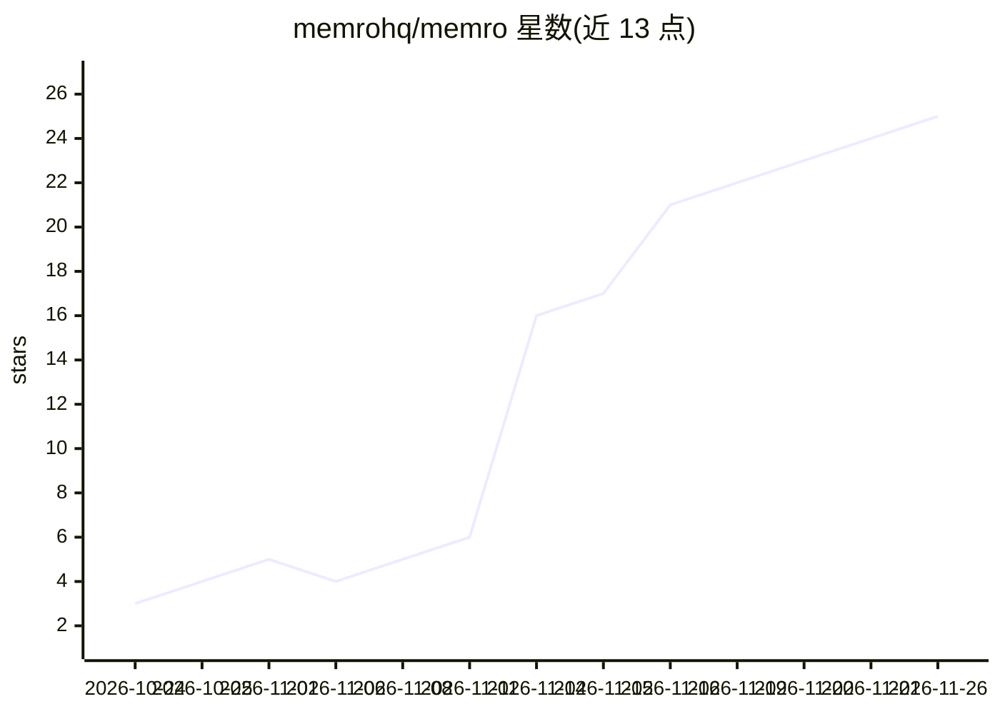

# memrohq/memro

⭐ 25 · Go · NOASSERTION · 推送 2026-11-22 · [GitHub](https://github.com/memrohq/memro) · [官网](https://memro.co) · 组织维护

**为 AI 编码工具提供跨工具共享长期记忆的 MCP 服务器与 SDK**

由 Memro 团队维护的长期记忆基础设施：通过 MCP 服务器与 Python/JS/Go SDK，让 Claude Code、Cursor、Codex、GitHub Copilot 等 AI 编码工具共享同一份跨会话记忆。Go API 服务器以 PostgreSQL+pgvector 为后端，检索结合向量余弦相似度与全文关键词搜索（RRF 融合）；记忆分为 semantic/episodic/procedural/profile 四类，支持时间加权查询、冲突检测与推理图谱。可托管于 Memro Cloud 或用 Docker Compose 自托管。许可为 PolyForm Noncommercial，非商业免费，商业用途需云订阅或商业授权。

## 筛选速览

| 维度 | 判定 | 备注 |
|---|---|---|
| AI 角色 | `ai-ecosystem` | LLM/agent 周边工具 |
| 许可风险 | `none` | NOASSERTION |
| 部署形态 | `self-host` | docker 或自建部署 |
| 模型依赖 | — | README 未给出锁定关系 |
| 硬件要求 | — | 无带数字的原话,不猜 |
| 安装摩擦 | `low` | 无编译、无系统依赖或容器化 |
| 成熟度 | — | 结构信号不足 |

## 能力要点

- 跨工具共享长期记忆（Claude Code/Cursor/Codex/Copilot 等 MCP 客户端）
- 向量+全文混合检索（RRF 融合），基于 PostgreSQL 与 pgvector
- 类型化记忆、时间演化查询与冲突检测解析
- Ed25519 密钥对身份认证，私钥不离开本地

## 适用场景

- 让 Cursor 会话回忆起在 Claude Code 中做出的项目决策
- 团队同步 Slack/GitHub/Linear/Notion 等来源的项目上下文
- 自托管部署，统一管理多个 AI 编码工具的记忆

## 场景标签

`Agent 记忆` · 领域:Agent 开发

## 证据(README 行号)

> L38: `github.com/memrohq/memro` is the single public repository for Memro: the Go server, official SDKs (Python, JavaScr
> L120: |`mcp/`|Model Context Protocol server (stdio & SSE HTTP)|MCP Guide|

## 星数曲线

2026-10-24 3 → 2026-11-26 25（+22）

---
*卡片 v1 · prompt 1.4 · 生成 2026-11-18 · 置信度 high · 依据 README sha `b6250767dc27` · [字段定义](../../DATASET.md)*
