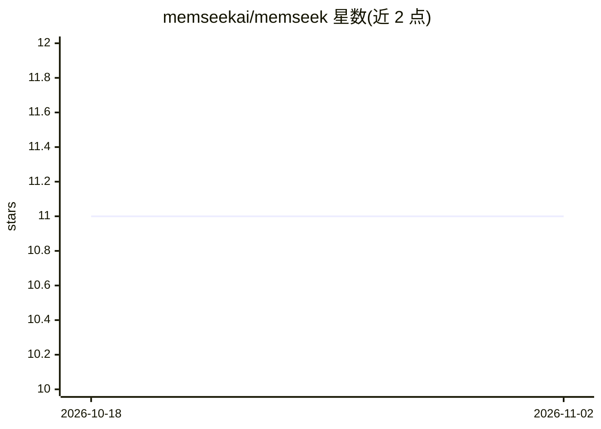

# memseekai/memseek

⭐ 11 · Python · Apache-2.0 · 推送 2026-09-28 · [GitHub](https://github.com/memseekai/memseek) · [官网](https://memseek.ai) · 组织维护

**面向 AI agent 的声明式上下文引擎：YAML 定义记忆，Postgres 上运行**

以版本化 YAML catalog 声明 agent 记忆的采集、推导、检索与上下文组装：记录进入不可变集合，经有界推导生成带引用的记忆，按声明 token 预算渲染 agent 上下文，并通过 MCP 暴露白名单工具。运行于用户自管的 Postgres（含 pgvector），提供异步 Python SDK、JSON HTTP API 与 MCP 接口，附带 Claude Code 插件与三个示例 catalog。本地快速路径需 Docker Compose 与 OPENAI_API_KEY。

## 筛选速览

| 维度 | 判定 | 备注 |
|---|---|---|
| AI 角色 | `ai-ecosystem` | LLM/agent 周边工具 |
| 许可风险 | `permissive` | Apache-2.0 |
| 部署形态 | `self-host` | docker 或自建部署 |
| 模型依赖 | — | README 未给出锁定关系 |
| 硬件要求 | — | 无带数字的原话,不猜 |
| 安装摩擦 | `low` | 无编译、无系统依赖或容器化 |
| 成熟度 | — | 结构信号不足 |

## 能力要点

- 版本化 YAML catalog 声明 Collection/Processor/Derivation/View/Artifact/MCP 等能力
- 每条事实带日期、引用与溯源，可回放任意时间点，过期事实被后继而非删除
- 按声明的 token 预算确定性地渲染 agent 上下文，超预算或伪造引用则不提交
- 提供 MCP 接口（工具白名单）、Python SDK、HTTP API 与 Claude Code 插件

## 适用场景

- 为 agent 维护可审计、带引用的长期记忆并自动组装任务上下文
- 从 CRM 历史或项目会话中推导当前事实与画像
- 以声明方式控制 agent 可调用的记忆检索与写入工具

## 场景标签

`Agent 记忆` · 领域:Agent 开发

## 证据(README 行号)

> L5: **The declarative context engine for AI agents.**
> L23: You define what to remember, how it changes, and what each task should see — in
> L277: Memseek has an async Python SDK, a JSON HTTP API, and MCP. The SDK keeps common

## 星数曲线

2026-10-18 11 → 2026-11-02 11（+0）

---
*卡片 v1 · prompt 1.4 · 生成 2026-11-02 · 置信度 high · 依据 README sha `db0305ed991a` · [字段定义](../../DATASET.md)*
