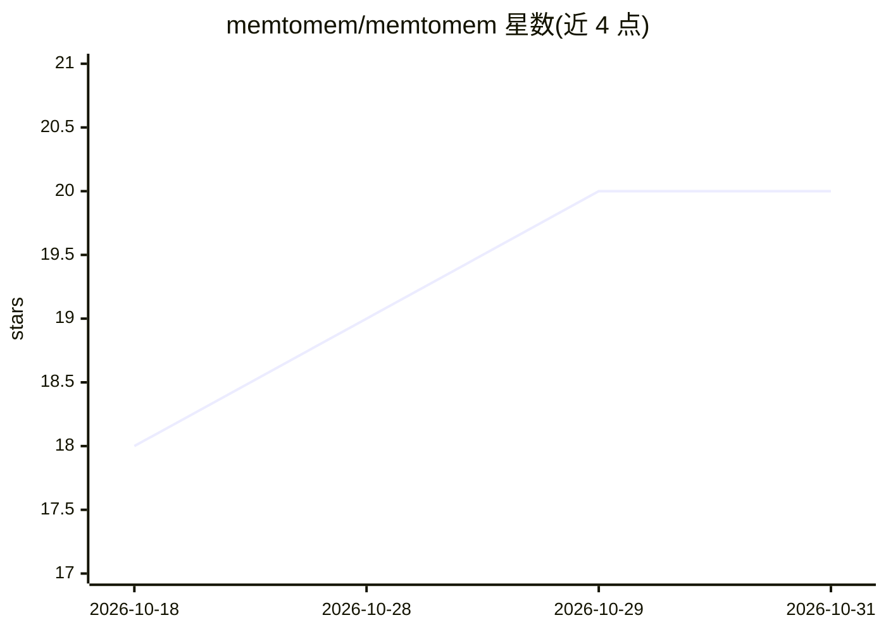

# memtomem/memtomem

⭐ 20 · Python · Apache-2.0 · 推送 2026-10-30 · [GitHub](https://github.com/memtomem/memtomem) · [官网](https://memtomem.com) · 个人维护 · 中文 README

**Markdown 优先的 AI agent 长期记忆基础设施（MCP 混合检索）**

将用户的 Markdown 笔记、文档与代码索引为可搜索知识库，通过 MCP 协议供 AI 编码 agent（Claude Code、Cursor 等）检索：BM25 关键词 + 稠密向量 + RRF 融合的混合搜索，标题感知/AST/结构感知分块，增量索引（chunk 级 SHA-256 差异）。.md 文件为事实源，数据库为可重建缓存；核心操作仅在显式调用时运行。提供 mm CLI、Web UI、命名空间、近重复检测与 TTL 等维护功能，以及 LangGraph Store 适配。Python 3.12+，uv/pipx 安装。

## 筛选速览

| 维度 | 判定 | 备注 |
|---|---|---|
| AI 角色 | `ai-ecosystem` | LLM/agent 周边工具 |
| 许可风险 | `permissive` | Apache-2.0 |
| 部署形态 | `library` | 以包/库形式分发 |
| 模型依赖 | local-ok | 支持本地模型 |
| 硬件要求 | — | 无带数字的原话,不猜 |
| 安装摩擦 | `low` | 无编译、无系统依赖或容器化 |
| 成熟度 | `idea` | |

## 能力要点

- BM25 + 稠密向量 + RRF 融合的混合检索
- Markdown/JSON/YAML/TOML/Python/JS-TS 的语义分块与增量索引（chunk 级 SHA-256）
- 九个核心 MCP 工具与 mm CLI，Web UI 仪表盘
- Context Gateway 管理项目级 Skills/Commands/Subagents 并推送至运行时

## 适用场景

- 让编码 agent 跨会话记住并检索我的笔记和项目知识
- 把散落的 Markdown 文档统一为 agent 可搜索的索引
- 为不同项目/作用域隔离记忆并通过 Web UI 管理

## 场景标签

`Agent 记忆` `知识库管理` · 领域:Agent 开发

## 证据(README 行号)

> L17: memtomem turns your markdown notes, documents, and code into a searchable knowledge base that any AI coding agent c
> L22:     B -->|Search| C["AI agent\n(Claude Code, Cursor, etc.)"]
> L151: - **MCP tools** — `mem_do` meta-tool routes all non-core actions in `core` mode for minimal context usage

## 星数曲线

2026-10-18 18 → 2026-10-31 20（+2）

---
*卡片 v1 · prompt 1.4 · 生成 2026-10-28 · 置信度 high · 依据 README sha `3cf005775fcb` · [字段定义](../../DATASET.md)*
