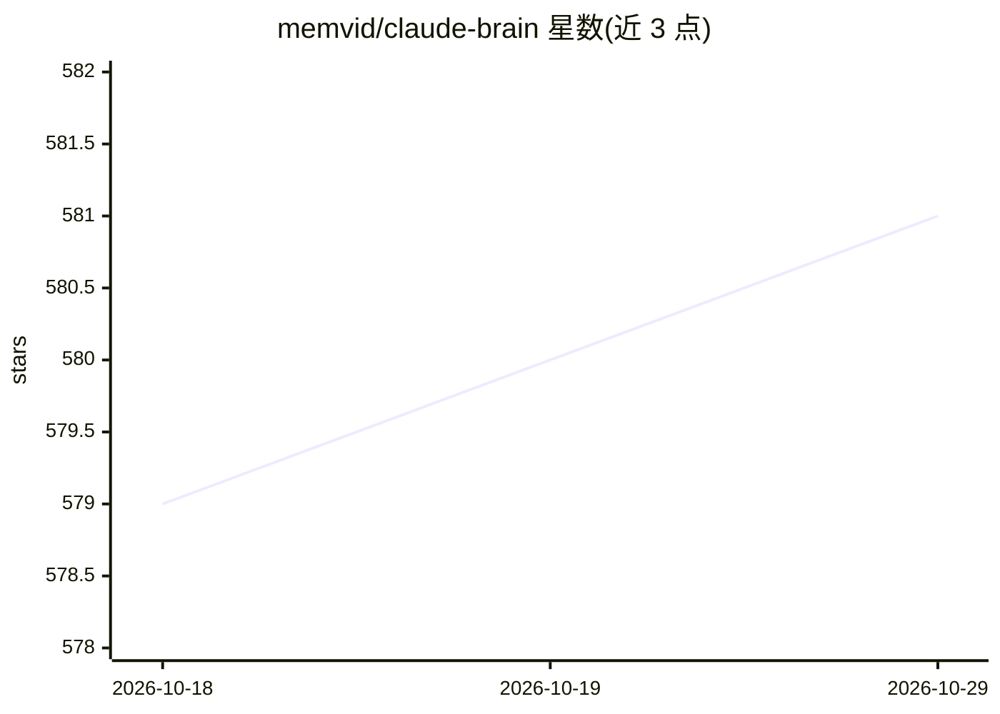

# memvid/claude-brain

⭐ 581 · TypeScript · MIT · 推送 2026-01-19 · [GitHub](https://github.com/memvid/claude-brain) · [官网](https://memvid.com) · 组织维护

**给 Claude Code 增加单文件跨会话记忆的插件**

面向 Claude Code 用户的记忆插件：将会话上下文、决策、bug 与解决方案写入项目目录下的单个 mind.mv2 文件，会话开始时自动注入，支持通过 /mind 命令做统计、搜索、提问与时间线查询。底层为 memvid 单文件记忆引擎，标称 Rust 原生核心、搜索亚毫秒级。数据完全本地，文件可 git 提交、scp 传输或分享给队友。另提供可选的 npm CLI 直接操作记忆文件。

## 筛选速览

| 维度 | 判定 | 备注 |
|---|---|---|
| AI 角色 | `ai-ecosystem` | LLM/agent 周边工具 |
| 许可风险 | `permissive` | MIT |
| 部署形态 | `library` | 以包/库形式分发 |
| 模型依赖 | — | README 未给出锁定关系 |
| 硬件要求 | — | 无带数字的原话,不猜 |
| 安装摩擦 | `low` | 无编译、无系统依赖或容器化 |
| 成熟度 | — | 结构信号不足 |

## 能力要点

- 单个 .mv2 文件存储记忆，可 git commit/scp/分享
- 会话上下文、决策、bug 与解决方案自动捕获并在会话开始注入
- /mind stats/search/ask/recent 命令
- 可选 memvid-cli 提供 stats/find/ask/timeline CLI 操作

## 适用场景

- 让 Claude Code 记住跨会话的项目决策和修复记录
- 把记忆文件提交到 git 做版本控制
- 通过分享 .mv2 文件给队友做项目上下文交接

## 场景标签

`Agent 记忆` · 领域:Agent 开发

## 证据(README 行号)

> L44: /plugin add marketplace memvid/claude-brain
> L53: After install, Claude's memory lives in one file:

## 星数曲线

2026-10-18 579 → 2026-10-29 581（+2）

---
*卡片 v1 · prompt 1.4 · 生成 2026-10-21 · 置信度 mid · 依据 README sha `1a8db3771ce6` · [字段定义](../../DATASET.md)*
