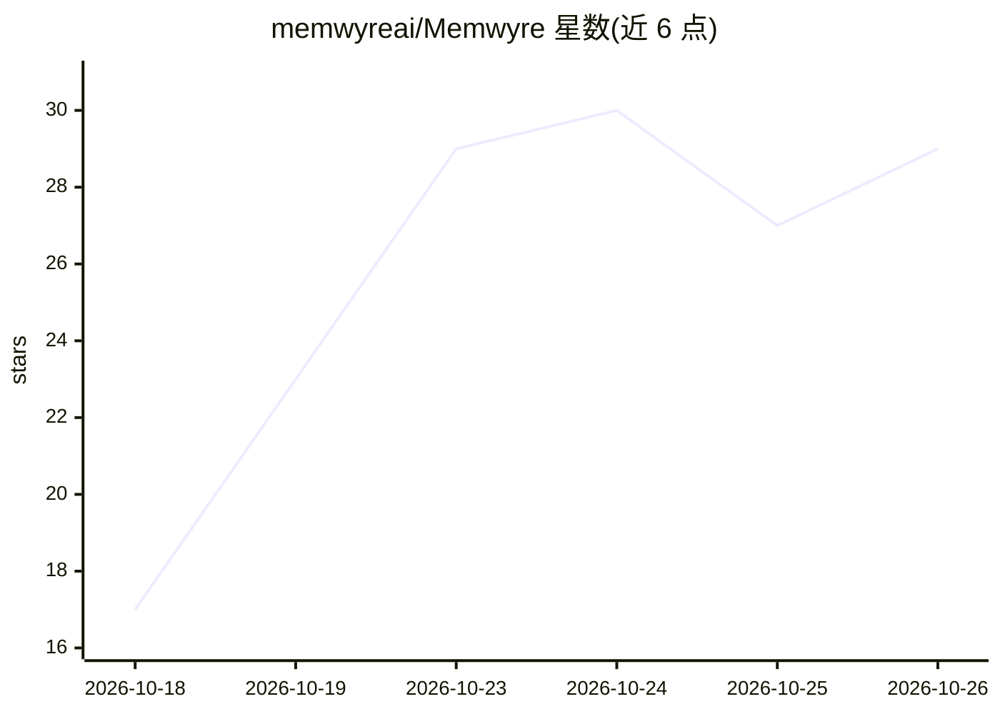

# memwyreai/Memwyre

⭐ 29 · Python · Apache-2.0 · 推送 2026-09-16 · [GitHub](https://github.com/memwyreai/Memwyre) · [官网](https://memwyre.tech) · 组织维护

**面向 LLM 与 AI agent 的开源持久记忆基础设施层**

为 LLM、AI agent 与自定义应用提供外部统一记忆库：摄取文档、网页、对话与工作流，异步分块、生成摘要并抽取事实关联，检索时并行执行关系事实查找与语义搜索，配合 Cross-Encoder 两阶段重排与艾宾浩斯对数衰减的时间降权。提供 Web 仪表盘、Chrome 扩展、MCP 服务器、CLI 与 OpenClaw 插件五种接入形态，通过 MCP 接入 Cursor、VS Code、Claude Desktop。自建需 Python 3.11/3.12、Node.js 18+、Redis，默认 SQLite、可选 PostgreSQL 与 Pinecone/ChromaDB。

## 筛选速览

| 维度 | 判定 | 备注 |
|---|---|---|
| AI 角色 | `ai-ecosystem` | LLM/agent 周边工具 |
| 许可风险 | `permissive` | Apache-2.0 |
| 部署形态 | `library` | 以包/库形式分发 |
| 模型依赖 | — | README 未给出锁定关系 |
| 硬件要求 | — | 无带数字的原话,不猜 |
| 安装摩擦 | `low` | 无编译、无系统依赖或容器化 |
| 成熟度 | — | 结构信号不足 |

## 能力要点

- 外部 LLM 无关的记忆层，经 MCP 接入 Cursor/VS Code/Claude Desktop
- 异步富化管线：去噪、摘要、实体抽取与原子事实关联
- 关系事实与语义向量并行检索，Cross-Encoder 两阶段重排
- 事实取代机制（supersession）与 project_id 项目级隔离

## 适用场景

- 在 Cursor、Claude Desktop 等工具间共享同一份持久记忆
- AI agent 接入统一记忆库做长期记忆与知识检索
- 通过审批收件箱人工审核自动采集的记忆条目

## 场景标签

`Agent 记忆` · 领域:Agent 开发

## 证据(README 行号)

> L19: Memwyre is an open-source, universal memory infrastructure and persistent knowledge retrieval layer for Large Langu
> L21: Rather than treating AI as stateless and losing context every time you switch between ChatGPT, Claude, Cursor, or d
> L61: * **3. Model Context Protocol (MCP) Server**: A Python server mapping memory tools (`search_memory`, `save_memory`,

## 星数曲线

2026-10-18 17 → 2026-10-26 29（+12）

---
*卡片 v1 · prompt 1.4 · 生成 2026-10-26 · 置信度 high · 依据 README sha `cc67942d3379` · [字段定义](../../DATASET.md)*
