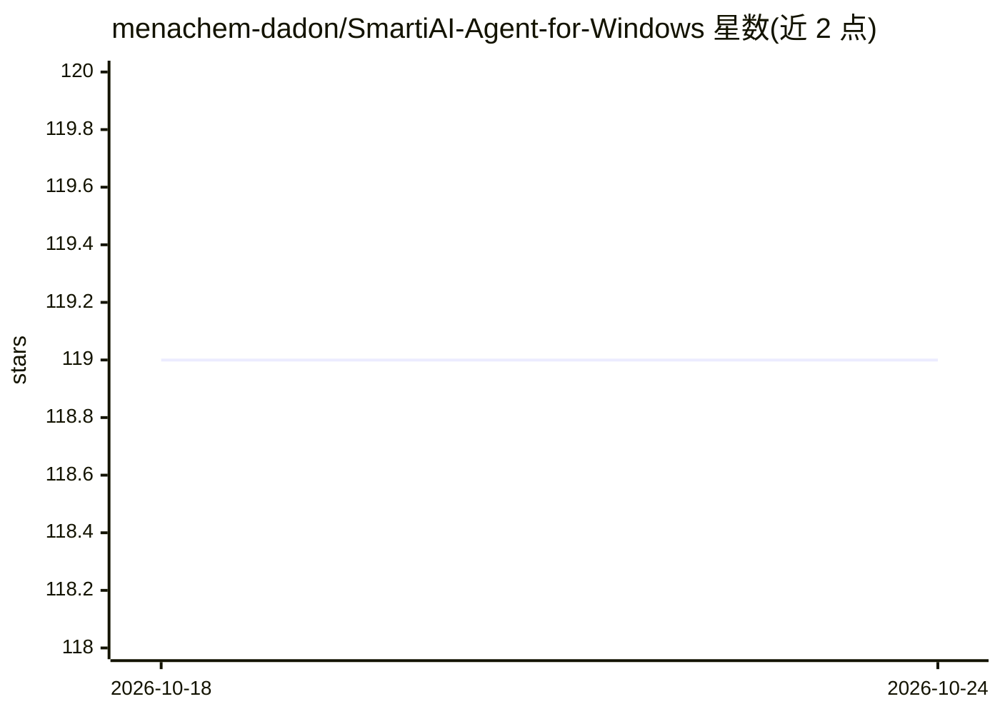

# menachem-dadon/SmartiAI-Agent-for-Windows

⭐ 118 · Python · NOASSERTION · 推送 2026-10-22 · [GitHub](https://github.com/menachem-dadon/SmartiAI-Agent-for-Windows) · 个人维护 · 中文 README

**面向 Windows 的本地优先桌面 AI agent，自动化操作系统**

SmartiAI 是运行于 Windows 的桌面 AI agent：通过规划-执行-验证的 agentic 流程操作本机，能力包括本地文件读写与 OCR、网页搜索与抓取、截图分析、Windows UI 自动化（点击/填表/热键）、Playwright/CDP 浏览器自动化、IMAP/SMTP 邮件处理、后台任务与提醒、本地分层记忆，并可通过自定义 Python 工具、MCP 包和 Skills 扩展。支持 20 家模型提供商及本地 OpenAI 兼容服务器。敏感操作受策略检查与用户审批控制。当前版本 V0.87.0，新版本不再使用 MIT 许可，界面正按 Tauri 重设计计划过渡。

## 筛选速览

| 维度 | 判定 | 备注 |
|---|---|---|
| AI 角色 | `ai-native` | 本体是模型或模型工具 |
| 许可风险 | `none` | NOASSERTION |
| 部署形态 | `desktop` | 安装包/桌面程序 |
| 模型依赖 | locked-api |  |
| 硬件要求 | — | 无带数字的原话,不猜 |
| 安装摩擦 | `low` | 无编译、无系统依赖或容器化 |
| 成熟度 | — | 结构信号不足 |

## 能力要点

- Agentic 任务执行：规划、分步进度、工具反馈、重试与最终验证
- Windows UI 自动化与 Playwright/CDP 浏览器自动化（嵌入式持久配置文件）
- 支持 20 家模型提供商与本地 OpenAI 兼容服务器，API key 经 Keyring/DPAPI 存储
- 自定义 Python 工具、MCP 包、Skills 扩展，敏感操作需审批

## 适用场景

- 让 agent 查找并总结下载目录中的发票 PDF
- 自动填表并提交网页表单，汇报结果
- 检查未读客户邮件并起草回复待审
- 创建可复用的文件处理 Python 工具

## 场景标签

`GUI 自动化` `浏览器自动化` `OCR` · 领域:效率与自动化

## 证据(README 行号)

> L5: SmartiAI Agent for Windows is a local-first desktop AI agent for practical work on a Windows computer. It combines a
> L19: - Agentic task execution with planning, step-by-step progress, tool feedback, retries, and final verification.

## 星数曲线

2026-10-18 119 → 2026-10-24 119（+0）

---
*卡片 v1 · prompt 1.4 · 生成 2026-10-23 · 置信度 high · 依据 README sha `7b31fbeb5a3a` · [字段定义](../../DATASET.md)*
