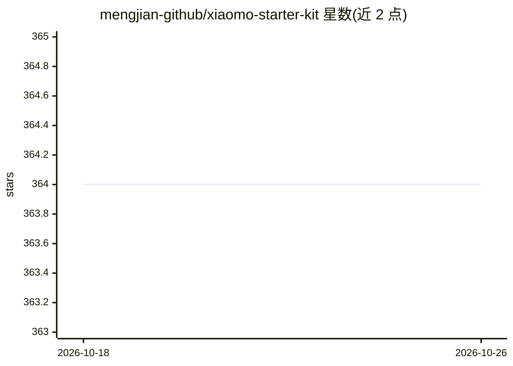

# mengjian-github/xiaomo-starter-kit

⭐ 364 · 推送 2026-02-01 · [GitHub](https://github.com/mengjian-github/xiaomo-starter-kit) · [官网](https://xiaomo.dev) · 个人维护 · 中文 README

**中文用户友好的 OpenClaw AI 私人助手预配置模板**

一个预配置的 OpenClaw（原 Clawdbot）AI 助手模板仓库：提供 SOUL.md/USER.md/IDENTITY.md 灵魂三件套、HEARTBEAT.md 心跳配置、MEMORY.md 记忆系统、AGENTS.md 行为准则与 TOOLS.md 工具笔记等文件，帮助中文用户跳过初始化，快速启动个人 AI 助手，并通过 Telegram/WhatsApp/Discord 使用。附推荐技能列表（clawdhub install 安装天气、任务管理、邮箱日历等）与 7 天上手指南。MIT 许可。

## 筛选速览

| 维度 | 判定 | 备注 |
|---|---|---|
| AI 角色 | `ai-ecosystem` | LLM/agent 周边工具 |
| 许可风险 | `none` | — |
| 部署形态 | `library` | 以包/库形式分发 |
| 模型依赖 | — | README 未给出锁定关系 |
| 硬件要求 | — | 无带数字的原话,不猜 |
| 安装摩擦 | `low` | 无编译、无系统依赖或容器化 |
| 成熟度 | — | 结构信号不足 |

## 能力要点

- SOUL/USER/IDENTITY 三件套与心跳、记忆系统等预配置模板文件
- 推荐 Skills 列表并附 clawdhub install 安装命令
- 接入 Telegram / WhatsApp / Discord 与助手对话
- 提供 7 天从入门到上手中文指南（飞书知识库）

## 适用场景

- 5 分钟搭建自己的 OpenClaw AI 私人助手
- 通过模板定制助手的性格、记忆与日常检查项
- 为助手安装天气、提醒、邮箱日历等实用技能

## 场景标签

`AI 助手` `提示工程` · 领域:Agent 开发

## 证据(README 行号)

> L11: 一个预配置好的 OpenClaw AI 助手模板，帮你跳过繁琐的初始化，**5 分钟拥有自己的 AI 私人助手**。
> L26: npm install -g openclaw
> L33: git clone https://github.com/mengjian-github/xiaomo-starter-kit.git my-assistant

## 星数曲线

2026-10-18 364 → 2026-10-26 364（+0）

---
*卡片 v1 · prompt 1.4 · 生成 2026-10-21 · 置信度 mid · 依据 README sha `0fdaa9ee6ec7` · [字段定义](../../DATASET.md)*
