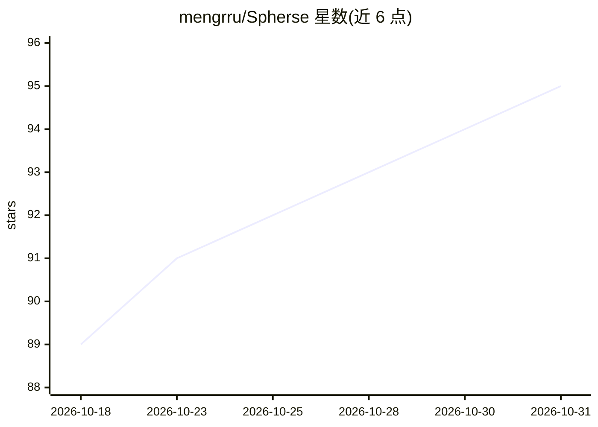

# mengrru/Spherse

⭐ 95 · TypeScript · MIT · 推送 2026-10-29 · [GitHub](https://github.com/mengrru/Spherse) · [官网](https://spherse.mengru.work) · 个人维护 · 中文 README

**本地运行的个人多 Agent 运行时与 Agent Workspace 平台**

基于 Electron 的桌面应用，让用户在一个项目目录内创建多个 Agent：每个 Agent 拥有独立系统提示词、工具权限、Skill、MCP Server 连接与多个 Session；通过 Cron 定时和自定义事件实现 Agent 自动化；内置本地 HTTP Preview Server 托管项目 HTML，页面可经 UI SDK 读写数据、创建会话、触发 Agent。项目目录作为完整分发单元，数据以普通文件、SQLite 形式保存在本地。桌面端提供 macOS/Windows/Linux 安装包，移动设备可通过 Web 客户端连接。安装后需配置受支持的 LLM Provider API Key。

## 筛选速览

| 维度 | 判定 | 备注 |
|---|---|---|
| AI 角色 | `ai-ecosystem` | LLM/agent 周边工具 |
| 许可风险 | `permissive` | MIT |
| 部署形态 | `desktop` | 安装包/桌面程序 |
| 模型依赖 | — | README 未给出锁定关系 |
| 硬件要求 | — | 无带数字的原话,不猜 |
| 安装摩擦 | `low` | 无编译、无系统依赖或容器化 |
| 成熟度 | — | 结构信号不足 |

## 能力要点

- 多 Agent 共享项目数据空间，各自独立配置、Skill 与 MCP Server
- Cron 与自定义事件驱动的 Agent 自动化网络
- HTML + UI SDK 将 Agent 与数据组合为可交互应用
- 整个 Workspace（数据+Agent+自动化+UI）以项目目录形式分发

## 适用场景

- 搭建由多个角色持续维护的世界观与互动叙事空间
- 建立带仪表盘、日报和自动整理的个人记录系统
- 组合多个研究、摘要、归档 Agent 的知识工作台
- 通过事件联动制作 AI 角色社区或文字游戏

## 场景标签

`多智能体` `Agent 框架` · 领域:Agent 开发

## 证据(README 行号)

> L5: **一个本地运行、开箱即用的个人 Agent 运行时。**
> L15: Spherse 是一套让用户运行 Agent、管理本地数据并消费自制内容的基础设施。
> L20: - **Agent 是独立的执行者**：每个 Agent 都可以拥有自己的系统提示词、工具权限、私有 Skill、MCP Server、会话和聊天主题。

## 星数曲线

2026-10-18 89 → 2026-10-31 95（+6）

---
*卡片 v1 · prompt 1.4 · 生成 2026-10-23 · 置信度 high · 依据 README sha `948234e8fac1` · [字段定义](../../DATASET.md)*
