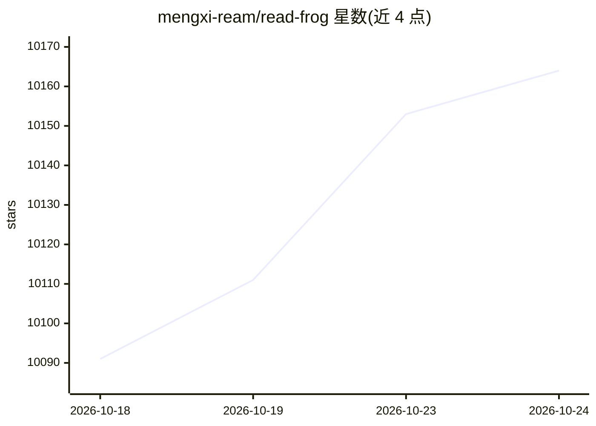

# mengxi-ream/read-frog

⭐ 10,173 · TypeScript · GPL-3.0 · 推送 2026-10-23 · [GitHub](https://github.com/mengxi-ream/read-frog) · [官网](https://www.readfrog.app) · 个人维护 · 中文 README

**开源 AI 语言学习浏览器扩展：网页/字幕翻译+FSRS 闪词卡**

浏览器扩展，面向各水平语言学习者：整页双语/纯译文翻译、划词翻译与讲解、TTS 朗读、上下文感知翻译，可翻译 YouTube/X/Netflix 字幕（无字幕 YouTube 可 AI 转录，属 Pro/Ultra 付费功能）。生词、释义、笔记存入 Notebase 并生成闪词卡，按间隔重复调度复习。支持 20+ AI 供应商（OpenAI/DeepSeek/Claude/Gemini/Ollama 等）及 Google/微软/DeepLX 免费翻译通道。以 GPLv3+商业双许可发布，含 Pro/Ultra 分层。

## 筛选速览

| 维度 | 判定 | 备注 |
|---|---|---|
| AI 角色 | `ai-native` | 本体是模型或模型工具 |
| 许可风险 | `dual` | GPL-3.0 |
| 部署形态 | `None` |  |
| 模型依赖 | local-ok | 支持本地模型 |
| 硬件要求 | — | 无带数字的原话,不猜 |
| 安装摩擦 | `low` | 无编译、无系统依赖或容器化 |
| 成熟度 | `idea` | |

## 能力要点

- 双语/纯译文两种整页翻译模式，切换时自动重译
- Notebase 生词收藏与 FSRS 间隔重复闪词卡复习
- 20+ AI 供应商接入（Vercel AI SDK），另含免费翻译通道
- 自定义 AI Action：自定 prompt 与结构化输出字段

## 适用场景

- 阅读外文网页时双语对照并顺手收藏生词
- 看 YouTube/Netflix 时显示双语字幕并查询字幕生词
- 用间隔重复闪词卡复习阅读中积累的词汇

## 场景标签

 · 领域:语言学习/翻译工具

## 证据(README 行号)

> L10: An AI language-learning extension for browsers, and an open-source alternative to Immersive Translate.
> L11: Translate web pages, the sentences you select, and subtitles on YouTube, X, and Netflix. Then save the words you me
> L128: Connect to 20+ AI providers through Vercel AI SDK: OpenAI, DeepSeek, Anthropic Claude, Google Gemini, xAI Grok, Gr

## 星数曲线

2026-10-18 10,091 → 2026-10-24 10,164（+73）

---
*卡片 v1 · prompt 1.4 · 生成 2026-10-20 · 置信度 high · 依据 README sha `a5c06b4aafd9` · [字段定义](../../DATASET.md)*
