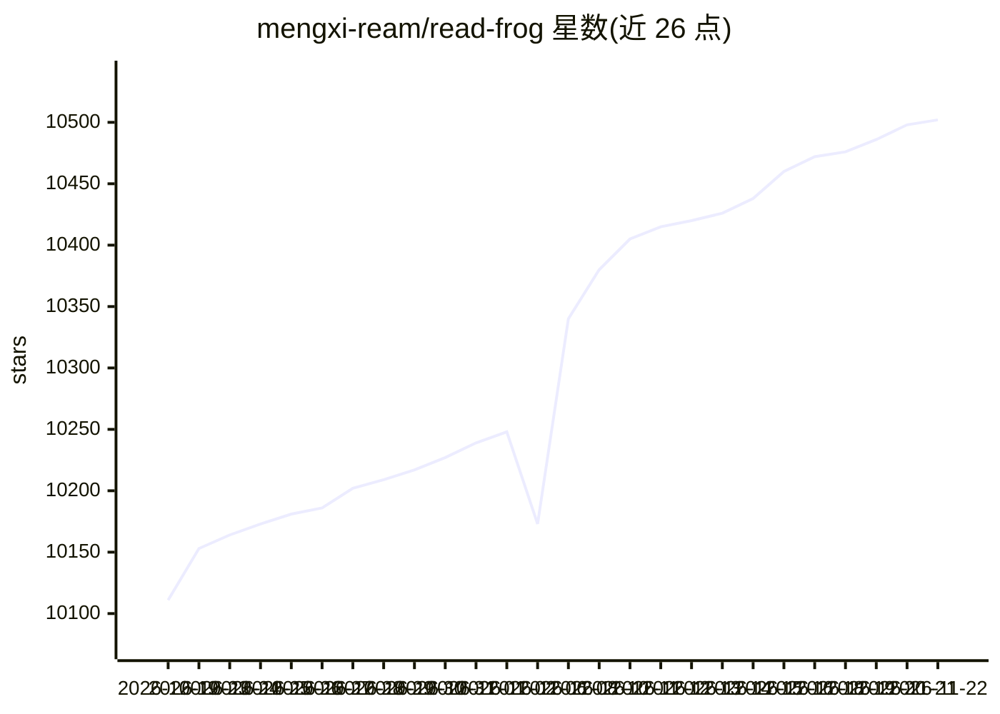

# mengxi-ream/read-frog

⭐ 10,502 · TypeScript · GPL-3.0 · 推送 2026-11-21 · [GitHub](https://github.com/mengxi-ream/read-frog) · [官网](https://www.readfrog.app) · 组织维护 · 中文 README

**浏览器 AI 语言学习扩展：翻译网页与字幕并生成闪卡复习**

面向语言学习者的浏览器扩展，提供网页翻译、划词翻译、双语对照、YouTube/X/Netflix 字幕翻译，并将阅读中遇到的词汇保存为闪卡，按 FSRS 间隔重复算法安排复习。用户可自定义 AI 动作（词典、改写、摘要），支持 TTS 朗读与上下文感知翻译。通过 Vercel AI SDK 接入 20+ AI 供应商，另有 Google Translate、Microsoft Translate、DeepLX 免费翻译通道。提供 Chrome/Edge/Firefox 安装包，中国区有 Chrome 商店镜像；项目处于活跃开发中。

## 筛选速览

| 维度 | 判定 | 备注 |
|---|---|---|
| AI 角色 | `ai-native` | 本体是模型或模型工具 |
| 许可风险 | `dual` | GPL-3.0 |
| 部署形态 | `None` |  |
| 模型依赖 | local-ok | 支持本地模型 |
| 硬件要求 | — | 无带数字的原话,不猜 |
| 安装摩擦 | `low` | 无编译、无系统依赖或容器化 |
| 成熟度 | — | 结构信号不足 |

## 能力要点

- 网页/划词/视频字幕翻译，支持双语与纯译文两种模式
- 词汇保存为闪卡并按 FSRS 间隔重复调度复习
- 通过 Vercel AI SDK 接入 20+ AI 供应商，可配置自定义端点与 API key
- 300+ 语音、70+ 语言的免费 TTS 与智能请求批量合并

## 适用场景

- 阅读外文网页时对照翻译并顺手积累生词闪卡
- 看 YouTube/Netflix 视频时显示双语字幕并查词
- 用自定义 AI 动作做查词、改写和摘要

## 场景标签

`语音合成` · 领域:内容生成

## 证据(README 行号)

> L10: An AI language-learning extension for browsers, and an open-source alternative to Immersive Translate.
> L11: Translate web pages, the sentences you select, and subtitles on YouTube, X, and Netflix. Then save the words you me
> L128: Connect to 20+ AI providers through Vercel AI SDK: OpenAI, DeepSeek, Anthropic Claude, Google Gemini, xAI Grok, Gr

## 星数曲线

2026-10-19 10,111 → 2026-11-22 10,502（+391）

---
*卡片 v1 · prompt 1.4 · 生成 2026-11-22 · 置信度 high · 依据 README sha `0a416c94f6b5` · [字段定义](../../DATASET.md)*
