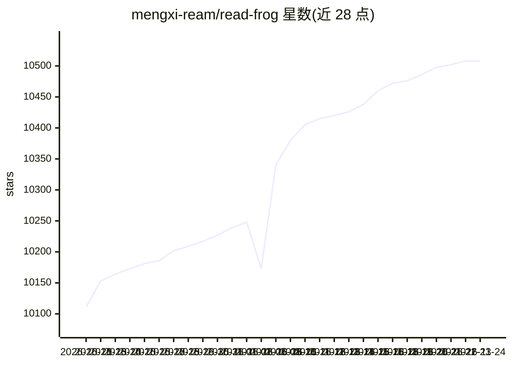

# mengxi-ream/read-frog

⭐ 10,520 · TypeScript · GPL-3.0 · 推送 2026-11-23 · [GitHub](https://github.com/mengxi-ream/read-frog) · [官网](https://www.readfrog.app) · 组织维护 · 中文 README

**面向语言学习者的浏览器扩展：网页/字幕翻译加闪卡复习**

开源浏览器扩展，将网页翻译与语言学习结合：支持整页双语对照或纯译文显示、划词翻译与解释、YouTube/X/Netflix 字幕翻译（无字幕 YouTube 可 AI 转写，限付费档），并可将生词、例句与笔记保存为闪卡，按 FSRS 间隔重复算法在线复习。通过 Vercel AI SDK 接入 20+ AI 提供商并支持自定义端点，提供批量请求合并、指数退避重试、上下文感知翻译与 300+ 语音的 TTS。另含自定义 AI Actions 机制，可将选中文本映射为可复用的结构化 AI 工具。Chrome/Edge/Firefox 商店安装，项目处于活跃开发中。

## 筛选速览

| 维度 | 判定 | 备注 |
|---|---|---|
| AI 角色 | `ai-enhanced` | 去掉 AI 部分产品仍成立 |
| 许可风险 | `dual` | GPL-3.0 |
| 部署形态 | `None` |  |
| 模型依赖 | local-ok | 支持本地模型 |
| 硬件要求 | — | 无带数字的原话,不猜 |
| 安装摩擦 | `low` | 无编译、无系统依赖或容器化 |
| 成熟度 | — | 结构信号不足 |

## 能力要点

- 整页双语/纯译文两种模式与划词流式翻译工具栏
- YouTube/X/Netflix 字幕同步翻译，无字幕视频可 AI 转写（Pro/Ultra）
- Notebase 闪卡与 FSRS 间隔重复复习调度
- 经 Vercel AI SDK 接入 20+ 提供商，支持批量请求合并降低 API 开销

## 适用场景

- 阅读外文网页时对照双语并随手收藏生词
- 看 YouTube/Netflix 视频时同步显示双语字幕
- 把阅读中遇到的词汇整理成闪卡定期复习

## 场景标签

 · 领域:教育/语言学习工具

## 证据(README 行号)

> L10: An AI language-learning extension for browsers, and an open-source alternative to Immersive Translate.
> L66: Turn selected text into reusable AI tools that match the way you read and learn. Define your own prompts and struct
> L126: ### 🤖 [20+ AI Providers][docs-providers]

## 星数曲线

2026-10-21 10,111 → 2026-11-24 10,508（+397）

---
*卡片 v1 · prompt 1.4 · 生成 2026-11-23 · 置信度 high · 依据 README sha `316e805e15d2` · [字段定义](../../DATASET.md)*
